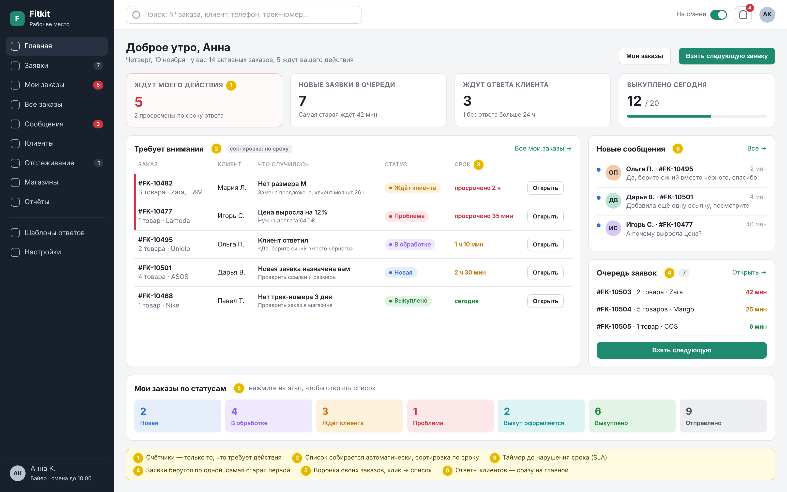
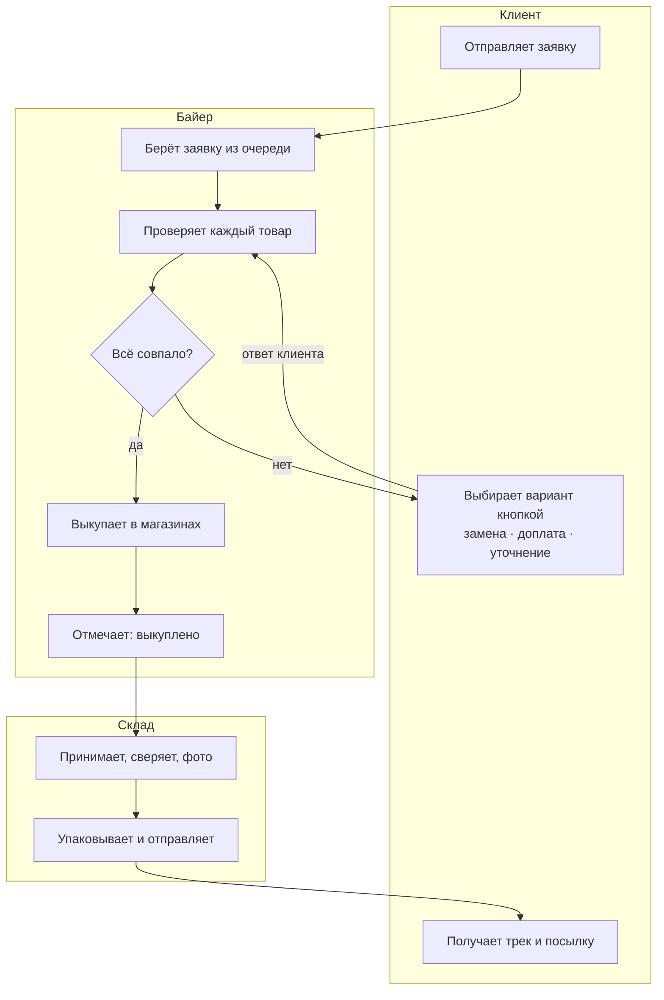
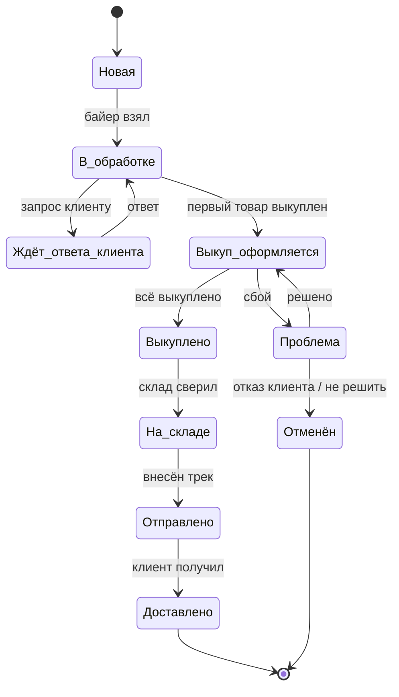

# Fitkit — рабочая программа сотрудника

19 ноября 2026 · Живая версия документа с комментариями: https://claude.ai/artifact/7y8TaGnefB8ZgFWDU5So63

Программа — это одно окно, где сотрудник Fitkit берёт заявку клиента, проверяет товары, выкупает их в магазинах, общается с клиентом и доводит заказ до отправки. Ниже — структура, функции, логика работы и макеты интерфейса для разработчиков.

## 1. Роли и задача программы

Главная задача — чтобы ни одна заявка не потерялась и сотрудник в каждый момент знал, что делать следующим. Программа — веб-приложение для компьютера (основной режим) с адаптивной версией для телефона: проверить статус и ответить клиенту можно в дороге.

| Роль | Что делает в программе | Доступ |
| --- | --- | --- |
| Байер (закупщик) | Берёт заявки, проверяет товары, выкупает их в магазинах, общается с клиентом | Свои заказы + общая очередь новых заявок |
| Старший смены | Распределяет заявки, разбирает проблемные заказы, одобряет возвраты и доплаты | Все заказы, отчёты по команде |
| Склад / логист | Принимает посылки из магазинов, сверяет, упаковывает, отправляет клиенту | Заказы в статусах «Выкуплено» и дальше |
| Администратор | Настраивает статусы, шаблоны сообщений, магазины, права, курсы и комиссии | Всё, включая настройки |

Клиент работает в своём приложении или боте Fitkit: присылает заявку, отвечает на вопросы, одобряет замену и оплачивает. В программе сотрудника он виден как карточка клиента и чат.

Дальше документ написан с точки зрения байера — основного пользователя.

## 2. Меню программы

Меню — левая вертикальная панель из 9 пунктов; у каждого счётчик того, что требует действия. Вверху — глобальный поиск (номер заказа, имя, телефон, трек-номер, номер заказа в магазине), колокольчик уведомлений и переключатель «На смене / Перерыв» (на перерыве новые заявки не назначаются).

| Раздел | Что внутри | Счётчик в меню |
| --- | --- | --- |
| Главная | Личная панель: задачи на сегодня, срочное, новые ответы клиентов (раздел 3) | — |
| Заявки | Очередь новых заявок, ещё не взятых в работу. Кнопка «Взять», сортировка по времени ожидания | Новые, не взятые |
| Мои заказы | Заказы сотрудника в двух видах: таблица и доска по статусам (канбан). Фильтры: статус, магазин, дедлайн, сумма | Требуют действия |
| Все заказы | То же по всей команде (нужно старшему и при подмене коллеги) | — |
| Сообщения | Единый инбокс всех чатов с клиентами; каждый чат привязан к заказу. Фильтр «Без ответа» | Непрочитанные |
| Клиенты | База клиентов: контакты, адреса, размеры, история заказов, заметки («просит не звонить», «не любит синтетику») | — |
| Отслеживание | Все посылки в пути: от магазина на склад и от склада к клиенту. Трек-номер, перевозчик, последнее событие, «застряли» | Задержки |
| Магазины | Справочник магазинов: аккаунт Fitkit, способ оплаты, доставка, сроки, таблицы размеров, условия возврата, заметки коллег | — |
| Отчёты | Личная статистика (выполнено, среднее время, просрочки); для старшего — по команде | — |

Внизу меню — «Шаблоны ответов», «Настройки» (для администратора) и профиль. Разделы «Заявки» и «Мои заказы» разделены намеренно: заявка — это то, что прислал клиент и что ещё никто не взял; после «Взять» она становится заказом конкретного байера.

## 3. Главная панель

После входа сотрудник видит не «статистику», а ответ на вопрос «что мне делать прямо сейчас». Всё, что требует его действия, собирается в один список и сортируется по сроку.

Блоки сверху вниз:

1. **Приветствие и главная кнопка.** «У вас 14 активных заказов, 5 ждут вашего действия» + кнопка «Взять следующую заявку».
2. **Четыре счётчика:** ждут моего действия (красный, если есть просрочки) · новые заявки в очереди · ждут ответа клиента · выкуплено сегодня из плана. Клик по счётчику открывает отфильтрованный список.
3. **«Требует внимания»** — главный блок. В каждой строке: номер заказа, клиент, **причина** («Клиент ответил», «Цена выросла на 12%», «Нет трек-номера 3 дня»), статус и таймер до нарушения срока. Просроченные строки — вверху, с красной меткой.
4. **Новые сообщения** — 3–5 последних непрочитанных ответов клиентов с номером заказа.
5. **Очередь заявок** — самые старые сверху, время ожидания, кнопка «Взять следующую».
6. **Мои заказы по статусам** — лента статусов с числом заказов в каждом; клик ведёт на доску с этим фильтром.

Что попадает в «Требует внимания» (правила для разработчиков):

- клиент написал или нажал кнопку ответа в заказе сотрудника;
- заказ в статусе «Проблема»;
- до нарушения срока осталось меньше 25% времени или срок уже нарушен;
- новая заявка назначена сотруднику старшим смены;
- выкупленный товар без трек-номера дольше заданного срока (по умолчанию 3 дня).

Макет главной панели (цифры в жёлтых кружках — пояснения для разработчиков):

## 4. Карточка заказа

Карточка — один экран, на котором есть всё для выкупа без переключений: слева товары, в центре клиент и доставка, справа чат. Главное решение — **каждый товар живёт отдельной строкой со своим статусом**: один товар может ждать замены, пока другие уже выкуплены.

**Шапка:** номер заказа, статус (выпадающий список), таймер срока, кнопки «Запросить уточнение», «Сообщить о проблеме», «Передать коллеге» и одна главная кнопка — следующий шаг («Начать проверку» → «Перейти к выкупу» → «Отметить: выкуплено»). Под шапкой — лента этапов с датами.

Как показывать то, что прислал клиент:

| Данные | Где в карточке | Как показывать и что можно сделать |
| --- | --- | --- |
| Фотографии одежды | Строка товара, слева | Миниатюра 96×120 с счётчиком фото; по клику — просмотр во весь экран с увеличением. Рядом — фото с сайта магазина (подтягивается по ссылке), чтобы сравнить «то ли это». Фото без ссылки помечается «нужно найти товар» |
| Ссылки на магазины | Строка товара, под названием | Домен + метка магазина, кнопки «Открыть в магазине ↗» (новая вкладка) и «Копировать». Система сама проверяет, что ссылка открывается, и подтягивает название, фото и цену. Товары группируются по магазинам — один выкуп на магазин |
| Размеры и цвета | Строка товара, сетка атрибутов | Отдельные поля: размер, цвет, количество, цена клиента, цена на сайте. Расхождение (нет размера, цена выше) выделяется красным. Ссылка на таблицу размеров магазина и мерки клиента из профиля |
| Адрес доставки | Центральная колонка | Одной строкой с кнопкой «Копировать» + отдельные поля (город, улица, дом, квартира, индекс) для форм магазинов. Получатель, способ и время доставки |
| Контакты | Центральная колонка, вверху | Имя, телефон, мессенджер, e-mail; отметка «предпочитает» у удобного канала. Номер заказа клиента в Fitkit и ссылка на профиль с историей |
| Пожелания клиента | Центральная колонка, жёлтая плашка | Дословно, в кавычках, заметным цветом. Если пожелание относится к конкретному товару — дублируется в его строке. Срок «нужно до» — отдельным полем-датой, он влияет на сортировку |

**Чек-лист товара.** Под каждым товаром — метки проверки: ссылка открывается · размер есть · цвет совпадает с фото · цена совпадает. Первые две и цена ставятся автоматически (если магазин отдаёт данные), цвет сотрудник подтверждает сам. Товар становится «Проверен», когда все 4 метки зелёные.

**Поля выкупа** (заполняет сотрудник): номер заказа в магазине, фактическая цена, дата, скриншот или PDF чека, трек-номер доставки от магазина.

**Итоги заказа:** стоимость товаров, доставка магазинов, комиссия Fitkit, оплачено клиентом и разница после проверки (доплата или возврат) — считаются автоматически.

**Правая панель:** вкладки «Чат с клиентом», «История» (все смены статусов и действия с автором и временем), «Файлы» (фото клиента, чеки, фото со склада). Ниже в центральной колонке — внутренние заметки сотрудников, клиент их не видит.

Макет карточки заказа:

## 5. Рабочий процесс сотрудника

Заказ проходит 6 шагов; на каждом у сотрудника одна главная кнопка, а проблема с любым товаром уводит в согласование с клиентом и обратно. Схема — ниже, по шагам:

Расхождение при проверке уводит заказ к клиенту и обратно на проверку; дальше заказ идёт по прямой от байера к складу и клиенту.

1. **Получить заявку.** Клиент отправляет заявку в боте или приложении — она попадает в «Заявки». Сотрудник нажимает «Взять следующую» (система даёт самую старую) или старший назначает её вручную. Клиент автоматически получает «Ваш байер — Анна, смотрим товары».
2. **Проверить товары.** По каждой строке: открыть ссылку, сравнить с фото клиента, проверить размер, цвет, цену и наличие. Если клиент прислал только фото — найти товар и вставить ссылку. Всё совпало → «Отметить проверенным».
3. **Согласовать расхождения** (если есть). Нет размера, цвета, товара или цена выросла → сотрудник предлагает замену, запрашивает доплату или уточнение (раздел 6). Заказ переходит в «Ждёт ответа клиента». Остальные товары можно выкупать, не дожидаясь ответа, если клиент не просил «только всё вместе».
4. **Выкупить.** Товары сгруппированы по магазинам. Сотрудник открывает сайт кнопкой «Открыть в магазине ↗», кладёт товары в корзину, копирует адрес из карточки и оплачивает. Потом вносит номер заказа в магазине, фактическую цену и чек. Ошибка на оплате или товар исчез из корзины → «Сообщить о проблеме», заказ получает статус «Проблема».
5. **Отметить выкуп.** Кнопка «Отметить: выкуплено» активна, только когда у всех товаров заполнен номер заказа и цена (или товар убран с согласия клиента). Клиент получает уведомление и чеки.
6. **Довести до отправки.** Трек-номера от магазинов вносятся вручную или из письма магазина → посылка приходит на склад → склад сверяет товар с карточкой и делает фото → упаковка → «Отправлено» с трек-номером для клиента. Заказ закрывается после доставки.

Правила, которые программа должна соблюдать сама:

- нельзя перейти к выкупу, пока есть непроверенные товары или неоплаченная доплата;
- если цена на сайте выше цены клиента больше чем на допуск (например, 3%; задаётся в настройках), товар требует согласования;
- при передаче заказа коллеге сотрудник оставляет обязательный комментарий «что сделано и что дальше»;
- каждое действие пишется в историю заказа: кто, что, когда.

## 6. Коммуникация с клиентом

Вся переписка идёт внутри заказа, а не в личных мессенджерах: так коллега может подхватить заказ, а спорные ситуации можно разобрать. Сообщения сотрудника уходят клиенту туда, откуда пришла заявка (бот, приложение), ответы клиента приходят в чат заказа.

Ключевой принцип — **вопрос с кнопками вместо свободного текста**. Клиент отвечает одним нажатием, и ответ сразу меняет товар и статус в карточке — сотруднику не нужно читать переписку и переносить данные вручную. Свободный чат остаётся для всего остального.

Три типа структурированных запросов:

| Запрос | Когда | Что видит клиент | Что происходит после ответа |
| --- | --- | --- | --- |
| Уточнение | Нет размера в заявке, непонятное фото, несколько товаров под одной ссылкой | Вопрос + варианты ответа кнопками («S / M / L») или поле для ответа | Ответ записывается в поле товара, заказ возвращается в «В обработке» |
| Замена товара | Нет размера, цвета или товара | До 3 вариантов с фото, ценой и разницей + «Убрать товар» и «Написать байеру» | Выбранный вариант заменяет товар; если есть доплата — клиент сразу получает счёт |
| Доплата / возврат | Цена выросла, доставка магазина платная, товар убран | Сумма, причина, кнопки «Оплатить» / «Убрать товар» | После оплаты товар разблокируется для выкупа |

**Как сотрудник согласует замену** (см. макет ниже):

1. В строке товара нажимает «Предложить замену» и выбирает причину из списка.
2. Вставляет до 3 ссылок на варианты; фото и цена подтягиваются, разница считается сама. Рядом видно пожелание клиента, чтобы не предложить лишнего.
3. Задаёт правило на случай молчания: сколько ждать (по умолчанию 24 ч), когда напомнить и что сделать потом (убрать товар / купить вариант без доплаты / передать старшему).
4. Проверяет текст из шаблона и нажимает «Отправить клиенту». Заказ уходит в «Ждёт ответа клиента», запускается таймер.
5. Клиент отвечает кнопкой → сотрудник получает уведомление, заказ появляется в «Требует внимания». Не ответил → срабатывает напоминание, затем заданное правило.

**Сообщить о проблеме.** Кнопка в шапке заказа открывает форму: тип проблемы (товар закончился, магазин отменил заказ, не проходит оплата, посылка задерживается, пришёл дефектный или не тот товар, другое), товары, комментарий, фото. Дальше два флажка: «Сообщить клиенту» (с готовым текстом из шаблона) и «Позвать старшего». Заказ получает статус «Проблема».

**Шаблоны ответов** с подстановками {имя}, {номер заказа}, {товар}, {сумма}: приветствие, нет размера, цена выросла, запрос фото, выкуплено, отправлено, задержка. Быстрые кнопки над полем ввода подбираются по статусу заказа. Внутренние заметки и упоминания коллег (@имя) клиент не видит.

Макет согласования замены — слева окно сотрудника, справа то, что видит клиент:

## 7. Статусы и уведомления

У заказа 10 статусов, у каждого свой цвет и свой срок. Статус заказа по возможности выставляется автоматически — по статусам товаров и действиям клиента; вручную меняются только «Проблема» и «Отменён». Сроки ниже — предложение для старта, бизнес уточнит их в настройках.

Из «Ждёт ответа клиента» и «Проблемы» заказ всегда возвращается на основной путь или закрывается отменой.

| Статус заказа | Что значит | Как попадает в статус | Срок (предложение) |
| --- | --- | --- | --- |
| Новая | Заявка пришла, никто не взял | Клиент отправил заявку | Взять за 30 мин |
| В обработке | Байер проверяет товары | «Взять» или ответ клиента | Проверить за 2 ч |
| Ждёт ответа клиента | Отправлен вопрос, замена или счёт на доплату | Структурированный запрос клиенту | 24 ч, напоминание через 12 ч |
| Проблема | Нужно решение байера или старшего | «Сообщить о проблеме» | Решить за 4 ч |
| Выкуп оформляется | Часть товаров уже куплена | Первый товар отмечен выкупленным | Довести за 4 ч |
| Выкуплено (покупка оформлена) | Все товары оплачены, ждём посылки | Все товары выкуплены или убраны | Трек от магазина за 3 дня |
| На складе | Посылки получены и сверены | Склад отметил все товары | Отправить за 1 день |
| Отправлено | Передано перевозчику, у клиента есть трек | Внесён трек-номер отправки | По данным перевозчика |
| Доставлено | Клиент получил, заказ закрыт | Статус перевозчика или клиент подтвердил | — |
| Отменён | Заказ не будет выкуплен, деньги возвращены | Клиент отказался или старший отменил | — |

У каждого **товара** свой статус: Новый → Проверен → Выкуплен → Получен на складе; в сторону — Нужна замена, Убран, Брак / возврат в магазин. Статус заказа вычисляется из статусов товаров (колонка «Как попадает»).

Уведомления — кому и когда:

| Событие | Байер | Клиент | Старший смены |
| --- | --- | --- | --- |
| Новая заявка | Счётчик в меню; если назначена ему — всплывающее уведомление | «Заявка принята, номер #…» | Если никто не взял за 30 мин |
| Заявка взята в работу | — | «Ваш байер — {имя}» | — |
| Клиент написал или ответил кнопкой | Всплывающее + звук + «Требует внимания» | — | — |
| Запрос клиенту (уточнение, замена, доплата) | — | Сообщение с кнопками ответа | — |
| Клиент молчит 12 ч / 24 ч | В 24 ч — «Требует внимания» | В 12 ч — напоминание | — |
| Срок статуса почти истёк (25% времени) | Жёлтый таймер | — | — |
| Срок нарушен | Красный таймер + уведомление | — | Уведомление |
| Проблема отмечена | — | Если стоит флажок «Сообщить клиенту» | Если стоит «Позвать старшего» |
| Выкуплено | — | «Всё куплено» + чеки | — |
| Отправлено | — | Трек-номер и ссылка на отслеживание | — |
| Посылка застряла (нет движения 5 дней) | «Требует внимания» + счётчик в «Отслеживании» | — | — |

Каналы: для сотрудника — внутри программы (колокольчик, счётчики, звук) и пуш в браузере; для клиента — тот канал, через который он прислал заявку. Уведомления не приходят сотруднику в режиме «Перерыв», клиенту — ночью (с 22:00 до 9:00 по его времени).

## 8. Аналоги: что взять у существующих сервисов

Готовой программы «под ключ» для такого сервиса нет: Fitkit совмещает личного закупщика, службу поддержки и логистику. Но у трёх групп сервисов есть проверенные решения, которые стоит перенять.

| Сервис | Что это | Что взять в Fitkit |
| --- | --- | --- |
| [Instacart](https://docs.instacart.com/connect/post-checkout_guide/concepts/replacement_flow) (приложение сборщика) | Сборщик покупает продукты за клиента в магазине | Сценарий замены: сборщик предлагает замену, клиент нажимает «Одобрить» или «Вернуть деньги»; если не ответил до кассы — замена покупается. Ответ клиента [сразу обновляет список покупок](https://company.instacart.com/shopper-community/providing-a-more-straightforward-replacements-experience), чат остаётся для остального. Это основа раздела 6 |
| Сервисы-агенты Superbuy, [Sugargoo](https://blog.sugargoo.com/?p=14031) | Выкуп товаров с китайских площадок по ссылке клиента | Контроль качества на складе: склад делает 3–5 фото товара, клиент видит их до отправки и может запросить возврат или обмен. В Fitkit — статус «На складе» с фото и статус товара «Брак / возврат» |
| Посредники с складом: Shopfans, USmall и др. ([обзор Т—Ж](https://t-j.ru/posredniki/)) | Склад за рубежом + пересылка клиенту | Консолидация: несколько посылок из разных магазинов ждут на складе и уходят одной отправкой. Раздел «Отслеживание» с двумя ногами пути: магазин → склад и склад → клиент |
| [Zendesk](https://support.zendesk.com/hc/en-us/articles/5604663490458-Using-SLA-policies) | Система обработки обращений поддержки | Сроки (SLA) с таймером в списках и сортировкой по оставшемуся времени; [представления «скоро нарушится срок»](https://support.zendesk.com/hc/en-us/articles/4408834732954); макросы — шаблоны ответов с подстановкой полей. Это основа блока «Требует внимания» и шаблонов |
| RetailCRM, amoCRM | CRM для интернет-магазинов и продаж | Настраиваемые статусы заказа и [автосообщения клиенту при смене статуса](https://oborot.ru/news/status-zakaza-mozhno-otpravit-klientu-v-socset-i80054.html); карточка клиента с историей заказов; воронка заказов по статусам (блок «Мои заказы по статусам») |
| Trello, Jira | Доски задач | Доска заказов по статусам с перетаскиванием карточек и фильтрами — второй вид раздела «Мои заказы» |
| Intercom, Jivo | Единый инбокс чатов из разных каналов | Одна лента сообщений из бота, приложения и почты; внутренние заметки и @упоминания коллег в том же чате |

Из этого следует рекомендация по реализации: на старте можно не писать всё с нуля — чат и рассылки клиентам строить на готовом сервисе (Telegram Bot API или аналоге), а своими силами делать карточку заказа, статусы и главную панель — именно их нет в готовых системах.

Описания функций — по публичным материалам сервисов (ссылки в таблице); правила и тарифы этих сервисов меняются, перед интеграцией стоит перепроверить.

## 9. Для разработчиков

**Основные сущности данных**

| Сущность | Ключевые поля |
| --- | --- |
| Клиент | имя, телефон, мессенджер + id чата, e-mail, предпочитаемый канал, часовой пояс, мерки и размеры, адреса (список), внутренние заметки |
| Заказ | номер, клиент, байер, статус, дедлайн статуса, «нужно до», адрес доставки (копия на момент заказа), пожелания, суммы (товары, комиссия, оплачено, разница), источник заявки |
| Товар (строка заказа) | ссылка, магазин, название, фото клиента, фото с сайта, размер, цвет, количество, цена клиента, цена на сайте, фактическая цена, статус товара, чек-лист, пожелание к товару |
| Выкуп | магазин, товары, номер заказа в магазине, сумма, валюта, способ оплаты, чек (файл), трек от магазина |
| Запрос клиенту | тип (уточнение / замена / доплата), товар, варианты, срок ответа, правило при молчании, ответ и время ответа |
| Сообщение | заказ, автор, канал, текст, вложения, внутреннее или клиентское, статус доставки и прочтения |
| Отправка | товары, перевозчик, трек-номер, вес, фото упаковки, события отслеживания |
| Магазин | домен, аккаунт, способ оплаты, сроки, таблица размеров, условия возврата, заметки |
| Событие истории | заказ, кто, что сделал, старое и новое значение, время |

**Интеграции**

- Канал заявок и чата с клиентом (бот в мессенджере и/или клиентское приложение): входящие заявки, сообщения в обе стороны, сообщения с кнопками ответа.
- Разбор ссылки на товар: название, фото, цена, наличие размеров (Open Graph, разметка товара schema.org, для крупных магазинов — отдельные парсеры). Если разобрать не удалось, поля заполняются вручную.
- Оплата для клиента: счёт на доплату, статус оплаты, возврат.
- Отслеживание посылок по трек-номеру (агрегатор трекинга или API перевозчиков).
- Курсы валют — если магазины зарубежные.

**Требования без функций**

- Работа в реальном времени: новые сообщения и смена статуса появляются без перезагрузки страницы.
- Два сотрудника не могут взять одну заявку: «Взять» — атомарная операция.
- Контакты клиента частично скрыты (как на макете), полные данные — по кнопке «Копировать», каждый просмотр пишется в историю. Данные карт и пароли от аккаунтов магазинов в программе не хранятся — только в менеджере паролей компании.
- Персональные данные хранятся по требованиям закона страны работы (для России — 152-ФЗ).
- Интерфейс рассчитан на экран от 1366 px; списки, карточка и чат работают на телефоне.

**Этапы разработки**

| Этап | Что входит |
| --- | --- |
| MVP | Заявки и «Взять», карточка заказа с товарами и чек-листом, статусы заказа и товара, чат с клиентом, запрос замены с кнопками, главная с «Требует внимания», история заказа |
| Второй этап | Таймеры сроков и автонапоминания, шаблоны ответов, разбор ссылок, доска по статусам, справочник магазинов, доплаты и возвраты |
| Третий этап | Отслеживание посылок, склад (приёмка, фото, упаковка), отчёты, мобильная версия |

## 10. Открытые вопросы к бизнесу

Ответы на эти вопросы меняют детали выше; в документе взяты разумные значения по умолчанию.

- [ ] Откуда приходят заявки — бот, приложение, сайт? От этого зависит канал чата и формат заявки.
- [ ] Магазины российские, зарубежные или и те, и другие? Нужны ли валюты, склад за рубежом и таможня?
- [ ] Клиент платит до выкупа (предоплата) или после проверки товаров? Как считается комиссия?
- [ ] Посылки идут через склад Fitkit или магазин везёт прямо клиенту? Во втором случае статус «На складе» не нужен.
- [ ] Какой срок ответа клиенту обещает Fitkit и в какие часы работают байеры? От этого зависят таймеры из раздела 7.
- [ ] Сколько байеров и заявок в день ожидается? Нужен ли старший смены с первого дня или заявки разбираются сами?
- [ ] Какой допуск по цене сотрудник может принять сам, без согласования с клиентом (в документе — 3%)?

---

## Файлы макетов

- `mockups/*.html` — исходники макетов (HTML + `styles.css`), открываются в браузере.
- `mockups/png/*.png` — картинки макетов.
- `mockups/render.js` — пересобрать картинки: `node mockups/render.js` (нужен Playwright).
