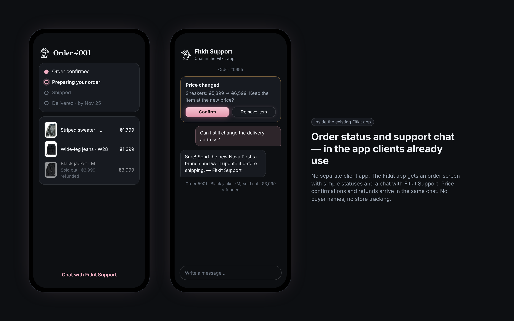
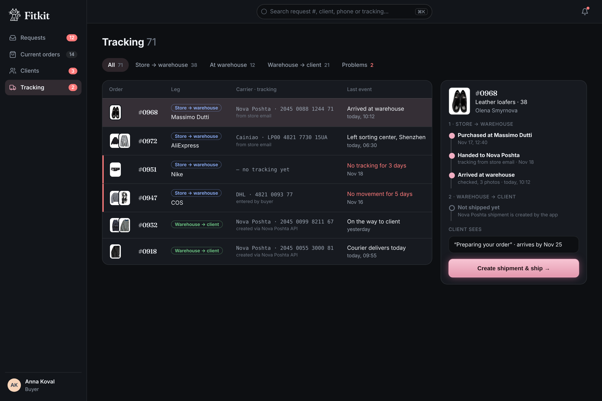

# Fitkit — Employee Workspace

Nov 23, 2026 · Live version with comments: https://claude.ai/artifact/7y8TaGnefB8ZgFWDU5So63

One app where a Fitkit buyer takes a client’s request, checks the items, buys them in online stores and gets the order shipped. The client never sees this: for them, Fitkit simply delivers the order. This spec covers the structure, rules, workflow and screens for developers. Prices are in Ukrainian hryvnia (₴).

## 1. Principles and navigation

- **Hidden mechanism.** The client sees only Fitkit — no buyer names, store names or store tracking. Parcels arrive in Fitkit packaging without store receipts or boxes.
- **No clarifying questions.** In the Fitkit app clients pick only sizes that are in stock, so the buyer doesn’t need to ask. Mismatches that still happen (a price change, an item sold out before purchase) are handled by **rules**, not chat (section 5).
- **Minimal UI for the buyer.** Four sections, one main button per screen. Analytics and settings live in a separate **admin back office**.

| Section | Contents |
| --- | --- |
| Requests | Incoming requests: new and overdue |
| Current orders | Orders in progress, as a status board |
| Clients | Client profiles and support tickets |
| Tracking | Both delivery legs: store → warehouse and warehouse → client |

The shift lead uses the same screens with an *All* filter; the warehouse works in Tracking.

## 2. Requests — the first screen

The buyer lands here: the total, one big **Take next request** button (the system hands out the oldest) and one row per request. Tabs: *All · New · Overdue*. Each row shows item thumbnails, number, client, stores, amount, status and time left; overdue rows go on top with a red bar. A click opens the request card.

## 3. Request card

**Left — items.** Each item shows the client’s photo, name and store, **size · quantity · price** in one line, the client comment, the item status and an **Open in store ↗** button. A mismatch appears right under the item together with **the rule that applies** and a one-click action: *sold out → Cancel & refund* (or *Check other stores*); *price up within 5% → covered by Fitkit automatically*. Below: the delivery address with *Copy*.

**Right — one compact panel:** owner, time left, what the client currently sees (“Preparing your order”), money (client paid, refunds, Fitkit fee, what Fitkit covers, amount to buy), the next step as a big pink button, *Problem* and *Hand over*, a quiet *Cancel order* link, and team notes. *Move to “Purchased”* stays blocked until every mismatch is resolved.

## 4. Current orders

A board with four columns — **In progress · Awaiting confirmation · Purchased · Shipped**; dragging a card changes the status. A card shows item photos, number, time left, client, amount (or parcel location) and at most one line: red for a problem, orange while a price confirmation is pending. The only filter is *Mine / All*.

## 5. Workflow, rules and statuses

1. **Take** the request (oldest first, or assigned by the shift lead).
2. **Check** each item against the client’s photo: size, colour, price, stock.
3. **Apply a rule** to any mismatch (table below) — no chat with the client.
4. **Buy** store by store, then enter the store order #, actual price and receipt.
5. **Mark as purchased** — only when every item is bought or cancelled by a rule.
6. **Ship** — the warehouse checks, photographs and repacks the items into Fitkit packaging and creates the Nova Poshta shipment.

| Situation | What happens | Client sees |
| --- | --- | --- |
| Price up ≤ 5% | Fitkit covers the difference, item is bought | Nothing |
| Price up > 5% | One-tap confirmation is sent; no answer in 24 h → item cancelled and refunded | “Price changed: Confirm / Remove item” |
| Sold out (size or colour) | Buyer may check other stores; otherwise item cancelled and refunded | “Item no longer available, money refunded” |
| Store cancelled, payment declined | Retry or another store; otherwise refund | Nothing, or a refund notice |
| Parcel lost or damaged | Shift lead decides: reorder or refund | A message from Fitkit Support |

Thresholds, wording and actions are set in the admin back office.

| Status (internal) | Meaning | Client sees | Due (default) |
| --- | --- | --- | --- |
| New | In the queue | Order confirmed | Take within 30 min |
| In progress | Checking and buying | Preparing your order | Check 2 h, buy 4 h |
| Awaiting confirmation | Price confirmation sent | Price changed (action) | 24 h |
| Purchased | On the way to the warehouse | Preparing your order | Store tracking in 3 days |
| Shipped | Nova Poshta parcel to the client | Shipped + tracking | Per carrier |
| Delivered | Closed | Delivered | — |

*Problem* is a red flag on any status. **Notifications:** the buyer is alerted about assignments, open support tickets, due times near or missed and stalled parcels; the shift lead about untaken requests and missed due times; the client gets order confirmed, price confirmation, item refunded, shipped (tracking) and delivered — never 22:00–09:00.

## 6. Clients and support

There is **no separate client app** and **no chat between the buyer and the client**. The client writes to **Fitkit Support** in the chat of the existing Fitkit app; each conversation becomes a **support ticket** linked to the order. In Clients the buyer (or a support agent) sees the client list with *All / Open tickets*, the ticket thread in the middle and the client’s details on the right (contacts, address, preferences, recent orders).

Replies are always signed **Fitkit Support** — never a buyer’s name, never a store name. Quick replies cover the common cases (order status, refund info, delivery date, change address); automatic events such as a refund appear in the thread for context. *Resolve* closes the ticket. Fitkit writes first only in exceptional cases (e.g. a lost parcel).

**In the existing Fitkit app** only two things are added: an order screen with simple statuses and its items (cancelled ones greyed out with the refund), and the Fitkit Support chat. Price confirmations (one tap) and refund notices arrive in the same chat, plus a push notification.

## 7. Tracking

Delivery has **two legs**, and both are tracked through APIs:

- **Store → warehouse.** Each store ships with its own carrier (AliExpress via Cainiao, Zara or H&M via DHL or UPS, Ukrainian stores via Nova Poshta). Instead of integrating each carrier, use a **tracking aggregator** (17TRACK, AfterShip, Ship24, TrackingMore): one API for 1,000+ carriers, carrier auto-detection and a webhook on every status change. Tracking numbers arrive **automatically from store shipping emails** sent to a dedicated mailbox, or are entered by the buyer; no number after 3 days → *Problems*.
- **Warehouse → client.** The app creates the Nova Poshta shipment through the Nova Poshta API and receives its statuses (Ukrposhta and Meest offer business APIs too).

Every event is stored once and shown twice: in full in Tracking, and simplified for the client — only “Preparing your order” with an estimated date until the warehouse ships, then the Nova Poshta tracking number. Store carriers are never shown to the client. On screen: tabs per leg, rows with a leg badge, carrier, tracking # and its source (store email, buyer, API), last event; the side panel shows both legs, what the client sees and *Create shipment & ship*. API pricing is per tracked parcel; check current rates before choosing.

## 8. For developers

| Entity | Key fields |
| --- | --- |
| Client | name, contacts, sizes, addresses, preferences, notes |
| Order | number, client, owner, internal status, client-facing status, due time, address, amounts in ₴ |
| Item | link, store, photos, size, colour, qty, client/site/actual price, status, rule applied |
| Rule | situation, threshold, action, client message (edited in the admin back office) |
| Purchase | store, store order #, amount, receipt |
| Shipment | leg (store → warehouse or warehouse → client), carrier, tracking #, source (email, buyer, API), events |
| Support ticket | order, client, status (open / resolved), messages signed “Fitkit Support” |
| History event | who, what, old → new value, time |

**Integrations:** the existing Fitkit app (order screen, support chat with action cards, push notifications); product-link parsing (Open Graph, schema.org, manual fallback); payments and refunds in ₴; a tracking aggregator with webhooks for the store → warehouse leg; the Nova Poshta API to create shipments and read statuses; a mailbox parser that pulls tracking numbers from store shipping emails. **Requirements:** real-time updates; atomic *Take*; masked contacts with every reveal logged; no card data or store passwords in the app; nothing store-related ever reaches the client; personal data under Ukrainian law and GDPR; layout from 1366 px plus a usable phone view.

| Stage | Scope |
| --- | --- |
| MVP | Requests, request card with rules, statuses, order screen and support chat in the Fitkit app |
| Stage 2 | Tracking aggregator + email parsing, Nova Poshta API, status board, store directory |
| Stage 3 | Warehouse (receiving, photos, repacking), admin back office with analytics, mobile |

**Brand style** follows [fitkit.space](https://fitkit.space/for-brands): dark theme (#0d0f12 page, #171a20 cards, #eef1f5 text), pink accent #f0aec2 with a soft glow on buttons (box-shadow 0 0 18px -2px rgba(255,132,178,.55)), cat logo with the “Fitkit” wordmark, Inter for the UI and Fraunces for the logo, order numbers and amounts. A light theme is a user setting.

**Admin back office (not in the buyer’s app).** Management opens it occasionally to check how the team works: requests per day, processing time, overdue share, issues and refunds by type, per-buyer performance. It also holds settings: rules and thresholds, statuses and due times, stores, user access.

## 9. Benchmarks

| Service | What to borrow |
| --- | --- |
| [Instacart](https://docs.instacart.com/connect/post-checkout_guide/concepts/replacement_flow) | The client approves a change or gets a refund in one tap → price confirmation |
| [Zendesk](https://support.zendesk.com/hc/en-us/articles/5604663490458-Using-SLA-policies) | Support tickets with due-time timers → support in Clients, Overdue tab |
| Trello, Jira | Drag-and-drop board → Current orders |
| Buying agents ([Sugargoo](https://blog.sugargoo.com/?p=14031)) | Warehouse photo check before shipping → Tracking |

Spend the build effort on the request card, rules and tracking — that is what ready-made tools lack.

---

## Mockup files

- `mockups/*.html` — mockup sources (HTML + `styles.css`, dark theme in fitkit.space colours), generated by `mockups/build.py`.
- `mockups/assets/` — logo and fonts (Inter, Fraunces) from the Fitkit site; `assets/photos/` — garments cut out from site photos on a white background.
- `mockups/png/*.png` — rendered screens.
- `mockups/render.js` — re-render: `node mockups/render.js` (needs Playwright).
