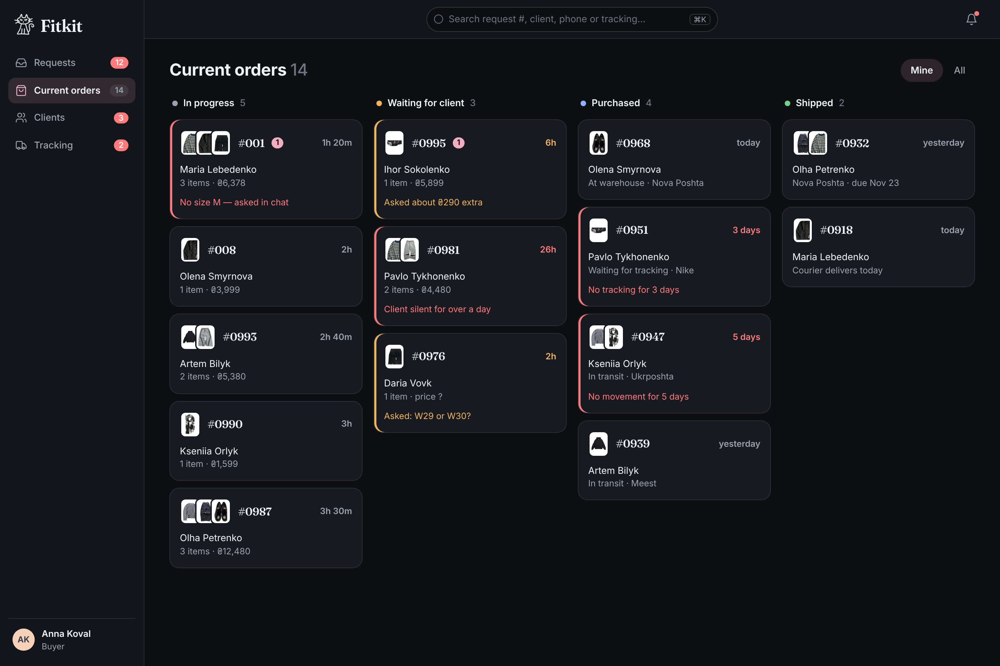
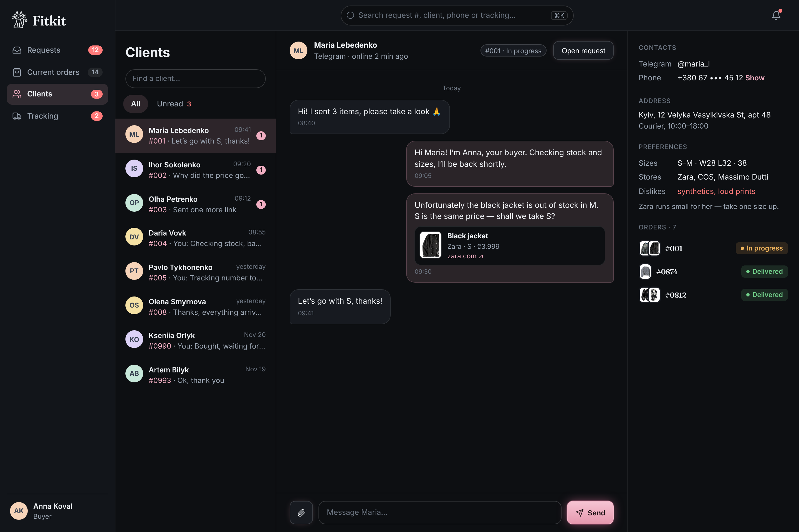
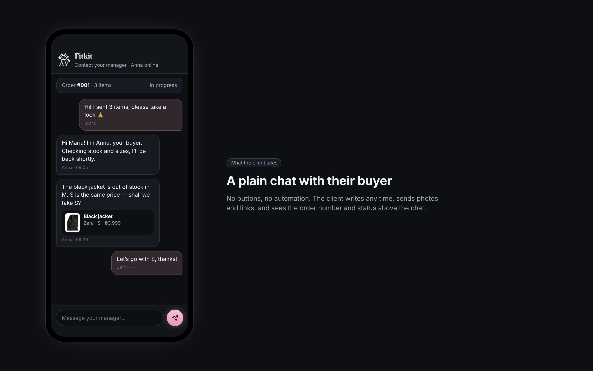

# Fitkit — Employee Workspace

Nov 23, 2026 · Live version with comments: https://claude.ai/artifact/7y8TaGnefB8ZgFWDU5So63

One app where a Fitkit buyer takes a client’s request, checks the items, buys them in online stores, talks to the client and gets the order shipped. This spec covers the structure, features, workflow and screen mockups for developers. Prices are in Ukrainian hryvnia (₴).

## 1. Roles and navigation

The workspace is built for the **buyer** and kept minimal: four sections, one main button per screen, no annotations or dashboards. The **shift lead** sees the same screens with an *All* filter; the **warehouse** works in Tracking. Analytics and settings live in a separate **admin back office**, not in the buyer’s app.

| Section | Contents |
| --- | --- |
| Requests | Incoming requests: new and overdue |
| Current orders | Orders in progress, as a status board |
| Clients | Client list with the chat, contacts, address, preferences and orders |
| Tracking | Purchases in transit, tracking numbers, delivery problems |

A request moves to Current orders when a buyer takes it, and to Tracking once everything is bought. Search in the top bar finds a request #, client, phone or tracking #.

## 2. Requests — the first screen

The buyer lands here: the total, one big **Take next request** button (the system hands out the oldest) and a table with one row per request. Tabs: *All · New · Overdue*. Each row shows item thumbnails, number, client, stores, amount, status and time left; overdue rows go on top with a red bar. A click opens the request card.

## 3. Request card

**Left — items.** Each item shows the client’s photo, name and store, **size · quantity · price** in one line (“price not set” if unknown), the **client comment**, the item status and an **Open in store ↗** button. A problem (e.g. no size M) appears right under the item with an *Ask client* link that opens the chat. Below the items: the delivery address with *Copy*.

**Right — one compact panel:** owner, time left, total in ₴ (priced items, Fitkit fee), the next step as a big pink button (*Move to “Purchased” →*), *Waiting for client* and *Problem*, and a quiet *Cancel order* link. Team notes sit under it. *Hand over* and other rare actions are in the “⋯” menu; history opens from the header. *Move to “Purchased”* stays blocked while an item has a problem.

## 4. Current orders

A board with four columns — **In progress · Waiting for client · Purchased · Shipped**; dragging a card changes the status. A card shows only item photos, number, time left, client, amount (or parcel location) and, if needed, one line in red (problem) or orange (waiting). A pink badge marks an unread client message. The only filter is *Mine / All*.

## 5. Workflow, statuses and notifications

1. **Take** the request (oldest first, or assigned by the shift lead).
2. **Check** each item against the client’s photo: size, colour, price, stock; find the link if only a photo was sent.
3. **Ask** in the chat about any mismatch and set *Waiting for client*; other items can be bought meanwhile.
4. **Buy** store by store, then enter the store order #, actual price and receipt.
5. **Mark as purchased** — only when every item has an order # and price, or was removed with consent.
6. **Ship** — warehouse checks and photographs the parcel, packs it, adds tracking for the client.

Rules: no buying with unchecked items or unpaid extras; a price above the client’s by more than 3% (configurable) needs their OK; handing over needs a note; every action is logged.

| Status | Meaning | Due (default) |
| --- | --- | --- |
| New | In the queue | Take within 30 min |
| In progress | Checking and buying | Check 2 h, buy 4 h |
| Waiting for client | Question asked in the chat | 24 h |
| Purchased | Paid, on the way to the warehouse | Store tracking in 3 days |
| Shipped | Client has tracking | Per carrier |
| Delivered | Closed | — |

*Problem* is a red flag on any status, not a status. Colours: grey on track, orange waiting, red problem, green done. **Notifications:** the buyer is alerted when a client writes, a request is assigned, a due time is near or missed, or a parcel stalls; the shift lead — about untaken requests and missed due times; the client — when the request is taken, purchased (with receipts) and shipped (tracking link), never 22:00–09:00.

## 6. Clients and chat

There is no separate Messages section: **chatting with a client happens in Clients**. The screen has three columns — the client list (search, *All / Unread*, last message, unread badge, order #), the chat in the middle, and the client’s details on the right: contacts (phone hidden until *Show*), address, **preferences** (sizes, favourite stores, dislikes, team note) and recent orders.

The chat is **plain — no automation, no choice buttons**. If a size is missing or a price changed, the buyer writes to the client (with a link or photo if needed), sets *Waiting for client*, and after the reply updates the request by hand. *Message client* and *Ask client* in the request card open this same chat. Internal problems get a red *Problem* flag; the shift lead is pulled in with an @mention in team notes.

The client sees **“Contact your manager”** in the bot or app: an ordinary chat with their buyer, the order number and status on top, and can write first at any time.

## 7. Tracking

Purchases in transit. Tabs carry the counts: *All · To warehouse · At warehouse · To clients · Problems*. Rows show photos, order #, store and carrier (Nova Poshta, Ukrposhta, Meest) with the tracking #, a five-dot stage and the last event; no tracking for 3+ days or no movement for 5+ days is red. A row opens a side panel with the parcel journey, a copyable tracking # and one next action (e.g. *Ship to client →*).

## 8. For developers

| Entity | Key fields |
| --- | --- |
| Client | name, contacts, main channel, sizes, addresses, preferences, notes |
| Order | number, client, owner, status, due time, address, amounts in ₴, source |
| Item | link, store, photos, size, colour, qty, client/site/actual price, status, comment |
| Purchase | store, store order #, amount, receipt, store tracking |
| Message | order, author, text, attachments, internal or client-facing, read |
| Shipment | carrier, tracking #, packing photo, events |
| History event | who, what, old → new value, time |

**Integrations:** client bot/app chat; product-link parsing (Open Graph, schema.org, manual fallback); payments in ₴; tracking via Nova Poshta, Ukrposhta and Meest APIs. **Requirements:** real-time updates; atomic *Take*; masked contacts with every reveal logged; no card data or store passwords in the app; personal data under Ukrainian law and GDPR; layout from 1366 px plus a usable phone view.

| Stage | Scope |
| --- | --- |
| MVP | Requests, request card, statuses, chat, history |
| Stage 2 | Timers, reply templates, link parsing, status board, store directory, payments |
| Stage 3 | Tracking, warehouse, admin back office with analytics, mobile |

**Brand style** follows [fitkit.space](https://fitkit.space/for-brands): dark theme (#0d0f12 page, #171a20 cards, #eef1f5 text), pink accent #f0aec2 with a soft glow on buttons (box-shadow 0 0 18px -2px rgba(255,132,178,.55)), cat logo with the “Fitkit” wordmark, Inter for the UI and Fraunces for the logo, order numbers and amounts. A light theme is a user setting.

**Admin back office (not in the buyer’s app).** Management opens it occasionally to check how the team works: requests per day, average processing time, overdue share, issues by type and per-buyer performance (requests, average time, overdue, issues). The same place holds settings — statuses, due times, price tolerance, stores, user access. The buyer’s app only sends events; it shows no stats.

## 9. Benchmarks

| Service | What to borrow |
| --- | --- |
| [Zendesk](https://support.zendesk.com/hc/en-us/articles/5604663490458-Using-SLA-policies) | Due-time timers and “about to breach” lists → Overdue tab |
| Trello, Jira | Drag-and-drop board → Current orders |
| Intercom | One inbox with internal notes and @mentions → chat in Clients |
| Buying agents ([Sugargoo](https://blog.sugargoo.com/?p=14031)) | Warehouse photo check before shipping → Tracking |

Build the chat on an existing channel (e.g. Telegram Bot API) and spend the effort on the request card, statuses and lists.

---

## Mockup files

- `mockups/*.html` — mockup sources (HTML + `styles.css`, dark theme in fitkit.space colours), generated by `mockups/build.py`.
- `mockups/assets/` — logo and fonts (Inter, Fraunces) from the Fitkit site; `assets/photos/` — garments cut out from site photos on a white background.
- `mockups/png/*.png` — rendered screens.
- `mockups/render.js` — re-render: `node mockups/render.js` (needs Playwright).
