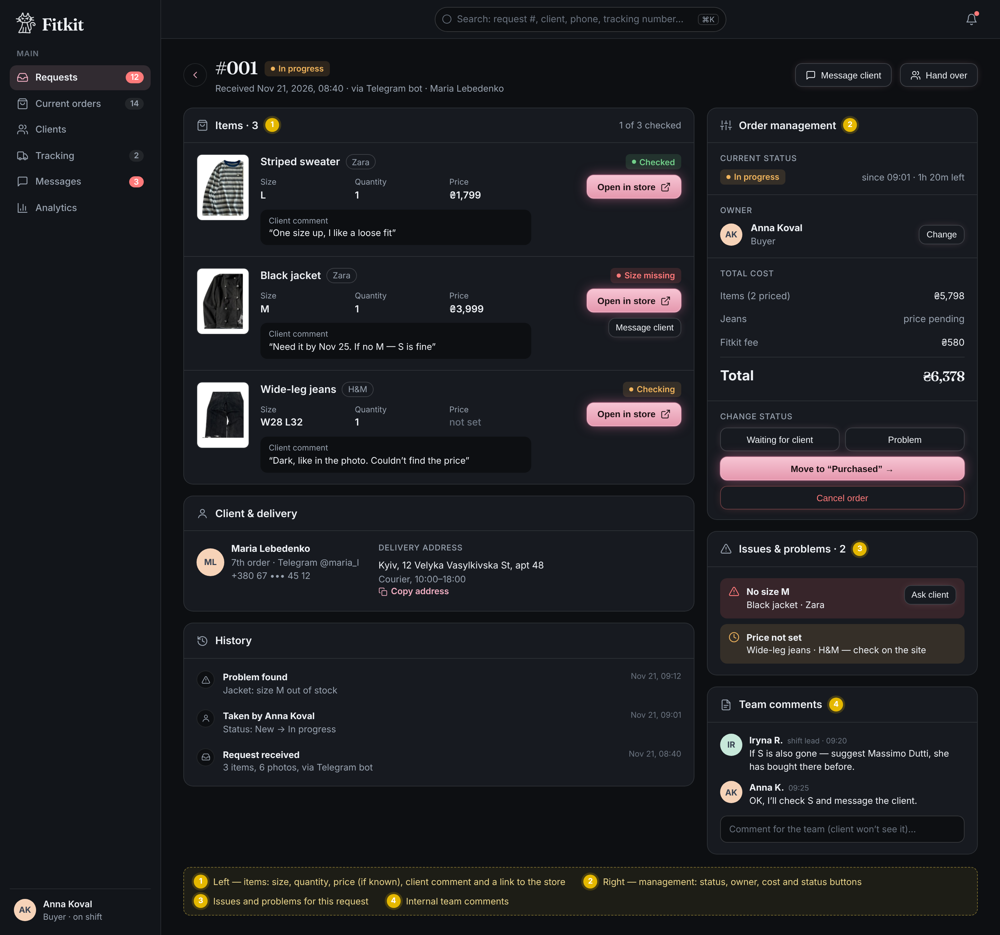
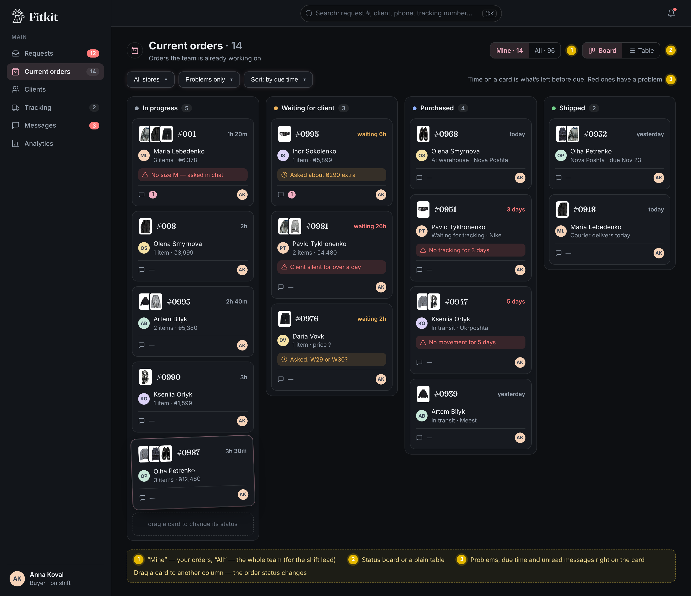
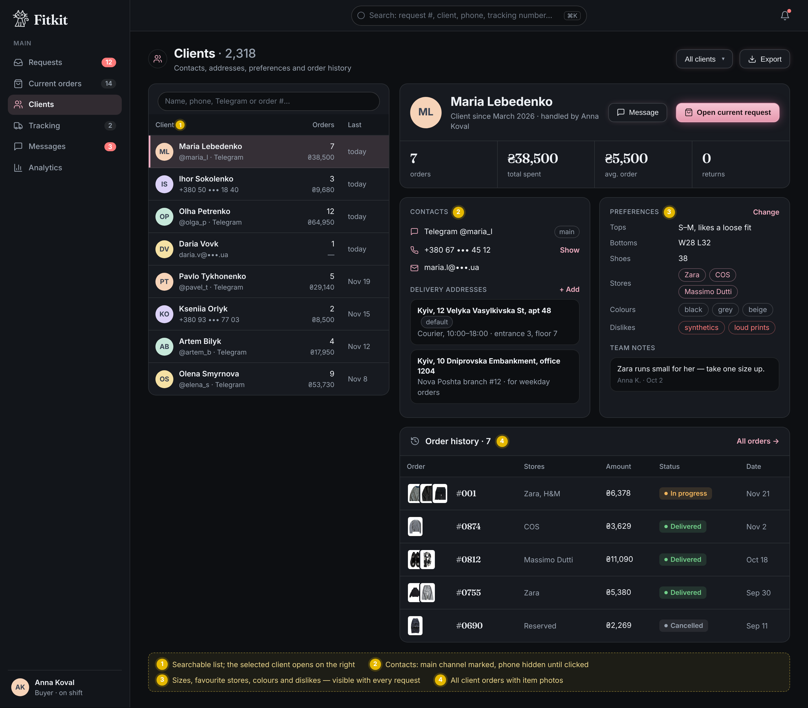
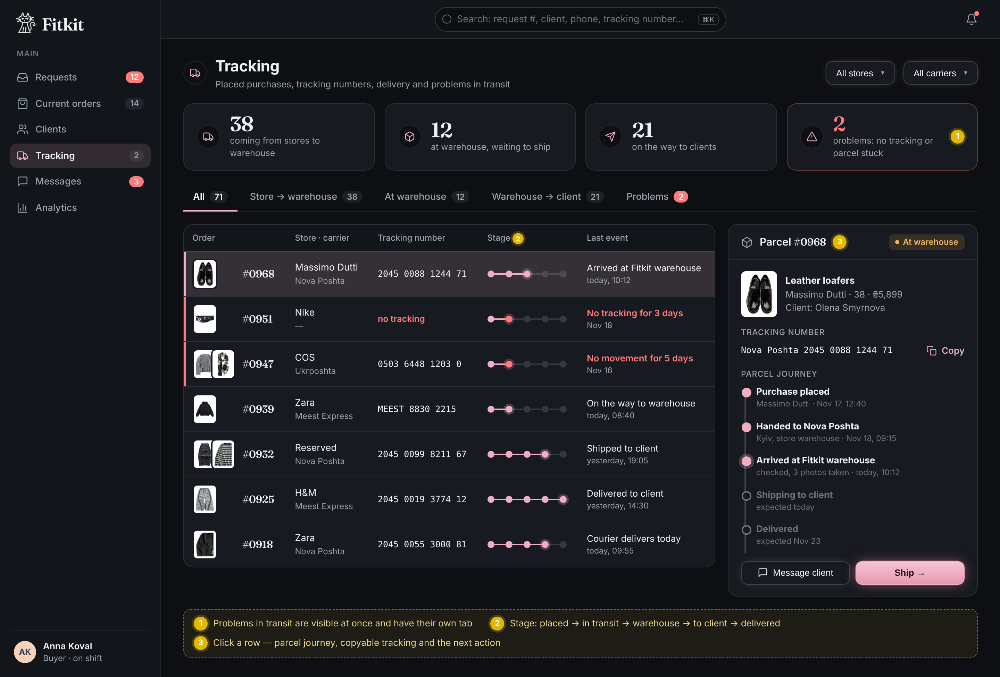
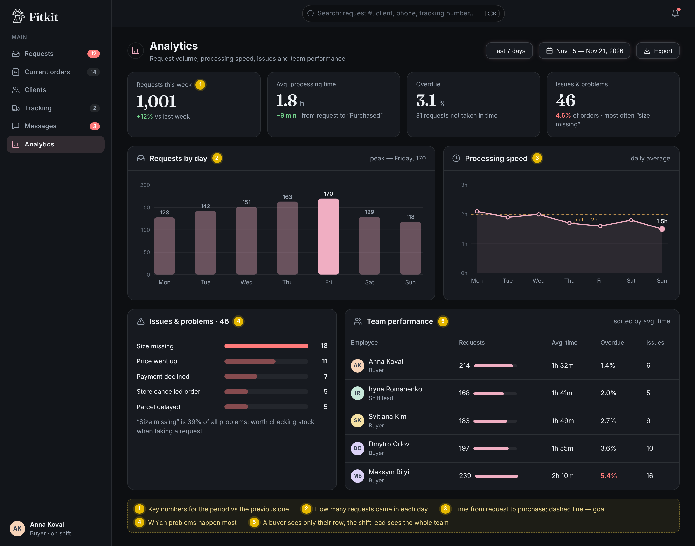

# Fitkit — Employee Workspace

Nov 21, 2026 · Live version with comments: https://claude.ai/artifact/7y8TaGnefB8ZgFWDU5So63

One app where a Fitkit buyer takes a client’s request, checks the items, buys them in online stores, talks to the client and gets the order shipped. This spec covers the structure, features, workflow and screen mockups for developers. Prices are in Ukrainian hryvnia (₴).

## 1. Roles and navigation

The main user is the **buyer**, who handles a request end to end. The **shift lead** assigns work and sees the whole team, the **warehouse** receives and ships parcels, the **admin** manages settings. Clients use the Fitkit bot or app. Desktop-first, with a mobile view for quick replies.

| Section | Contents |
| --- | --- |
| Requests | All incoming requests: new, awaiting, overdue |
| Current orders | Orders in progress, as a status board |
| Clients | Contacts, order history, addresses, preferences |
| Tracking | Purchases in transit, tracking numbers, delivery problems |
| Messages | Chats with clients about sizes, substitutions, details |
| Analytics | Volume, processing speed, issues, team performance |

A request moves to Current orders when a buyer takes it, and to Tracking once everything is bought. Search in the top bar finds a request #, client, phone or tracking #.

## 2. Requests — the first screen

The buyer lands here: a total (“Requests · 1,001”), a **Take next request** button (the system hands out the oldest) and one row per request. Tabs: *All · New · Awaiting · Overdue*. Each row shows item thumbnails, number, client, stores, amount, status, time received, time left and owner; overdue rows go on top with a red bar. A click opens the request card.

## 3. Request card

Two columns: **left — what the client sent, right — order management**. The header has the number, status, source and the buttons *Message client* and *Hand over*.

**Left — items.** Each item shows the client’s photo, name and store, **size, quantity, price if known**, the **client comment** verbatim, the item status and a mandatory **Open in store ↗** button. Below: client contacts and address (with Copy) and the action history.

**Right — management:** current status and time left; owner (*Change*); total cost in ₴ (priced items, pending prices, Fitkit fee); status buttons — the next step as a big pink button plus *Waiting for client*, *Problem*, *Cancel order*; a list of issues (red blocks the purchase, orange needs a check, *Ask client* opens the chat); internal team comments. *Move to “Purchased”* stays blocked while red issues remain.

## 4. Current orders

A board with four columns — **In progress · Waiting for client · Purchased · Shipped** (or a table view). Dragging a card changes the status. Cards show item photos, number, time left, client, amount or parcel location, unread messages and owner; problems are red, waiting is orange. Filters: *Mine / All*, store, *Problems only*, sort by due time.

## 5. Workflow, statuses and notifications

1. **Take** the request (oldest first, or assigned by the shift lead).
2. **Check** each item against the client’s photo: size, colour, price, stock; find the link if only a photo was sent.
3. **Ask** in the chat about any mismatch and set *Waiting for client*; other items can be bought meanwhile.
4. **Buy** store by store, then enter the store order #, actual price and receipt.
5. **Mark as purchased** — only when every item has an order # and price, or was removed with consent.
6. **Ship** — warehouse checks and photographs the parcel, packs it, adds tracking for the client.

Rules: no buying with unchecked items or unpaid extras; a price above the client’s by more than 3% (configurable) needs their OK; handing over needs a note; every action is logged.

| Status | Meaning | Due (default) |
| --- | --- | --- |
| New | In the queue | Take within 30 min |
| In progress | Checking and buying | Check 2 h, buy 4 h |
| Waiting for client | Question asked in the chat | 24 h |
| Purchased | Paid, on the way to the warehouse | Store tracking in 3 days |
| Shipped | Client has tracking | Per carrier |
| Delivered | Closed | — |

*Problem* is a red flag on any status, not a status. Colours: grey on track, orange waiting, red problem, green done. **Notifications:** the buyer is alerted when a client writes, a request is assigned, a due time is near or missed, or a parcel stalls; the shift lead — about untaken requests and missed due times; the client — when the request is taken, purchased (with receipts) and shipped (tracking link), never 22:00–09:00.

## 6. Communication

A **plain chat — no automation, no choice buttons**. If a size is missing or a price changed, the buyer writes to the client, with a link or photo if needed, sets *Waiting for client*, and after the reply updates the request by hand. **Messages** shows the chat list (filters *All / Unanswered / Mine*), the conversation and a request summary. Internal problems get a red *Problem* flag; the shift lead is pulled in with an @mention in team comments.

The client sees **“Contact your manager”**: an ordinary chat with their buyer, the order number and status on top, and can write first at any time.

## 7. Clients

Searchable list on the left, profile on the right: totals (orders, spent, average order, returns), contacts (main channel marked, phone hidden until clicked), delivery addresses (one default; courier or Nova Poshta branch), **preferences** (sizes, favourite stores, colours, dislikes — shown with every request), team notes and order history with item photos.

## 8. Tracking

Purchases in transit with four counters that double as tabs: *to warehouse · at warehouse · to clients · problems*. Rows show photos, order #, store and carrier (Nova Poshta, Ukrposhta, Meest), tracking #, a five-dot stage and the last event; no tracking for 3+ days or no movement for 5+ days is red. A row opens the parcel journey, a copyable tracking # and the next action.

## 9. Analytics

For a chosen period: requests, average processing time, overdue share and issues vs the previous period; requests by day; processing speed against a goal; issues by type; team performance. Buyers see only their own row. Figures are illustrative.

## 10. For developers

| Entity | Key fields |
| --- | --- |
| Client | name, contacts, main channel, sizes, addresses, preferences, notes |
| Order | number, client, owner, status, due time, address, amounts in ₴, source |
| Item | link, store, photos, size, colour, qty, client/site/actual price, status, comment |
| Purchase | store, store order #, amount, receipt, store tracking |
| Message | order, author, text, attachments, internal or client-facing, read |
| Shipment | carrier, tracking #, packing photo, events |
| History event | who, what, old → new value, time |

**Integrations:** client bot/app chat; product-link parsing (Open Graph, schema.org, manual fallback); payments in ₴; tracking via Nova Poshta, Ukrposhta and Meest APIs. **Requirements:** real-time updates; atomic *Take*; masked contacts with every reveal logged; no card data or store passwords in the app; personal data under Ukrainian law and GDPR; layout from 1366 px plus a usable phone view.

| Stage | Scope |
| --- | --- |
| MVP | Requests, request card, statuses, chat, history |
| Stage 2 | Timers, reply templates, link parsing, status board, store directory, payments |
| Stage 3 | Tracking, warehouse, analytics, mobile |

**Brand style** follows [fitkit.space](https://fitkit.space/for-brands): dark theme (#0d0f12 page, #171a20 cards, #eef1f5 text), pink accent #f0aec2 with a soft glow on buttons (box-shadow 0 0 18px -2px rgba(255,132,178,.55)), cat logo with the “Fitkit” wordmark, Inter for the UI and Fraunces for the logo, order numbers and amounts. A light theme is a user setting.

## 11. Benchmarks

| Service | What to borrow |
| --- | --- |
| [Zendesk](https://support.zendesk.com/hc/en-us/articles/5604663490458-Using-SLA-policies) | Due-time timers and “about to breach” lists → Overdue tab |
| Trello, Jira | Drag-and-drop board → Current orders |
| Intercom | One inbox with internal notes and @mentions → Messages |
| Buying agents ([Sugargoo](https://blog.sugargoo.com/?p=14031)) | Warehouse photo check before shipping → Tracking |

Build the chat on an existing channel (e.g. Telegram Bot API) and spend the effort on the request card, statuses and lists.

---

## Mockup files

- `mockups/*.html` — mockup sources (HTML + `styles.css`, dark theme in fitkit.space colours), generated by `mockups/build.py`.
- `mockups/assets/` — logo and fonts (Inter, Fraunces) from the Fitkit site; `assets/photos/` — garments cut out from site photos on a white background.
- `mockups/png/*.png` — rendered screens.
- `mockups/render.js` — re-render: `node mockups/render.js` (needs Playwright).
