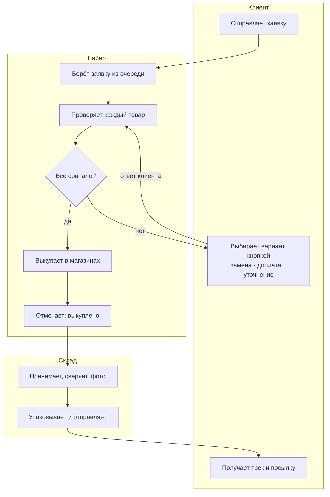
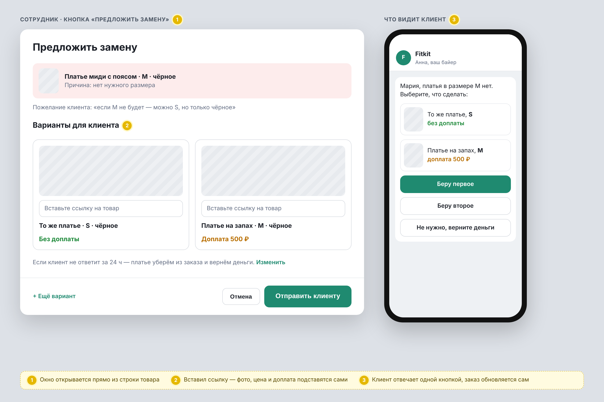
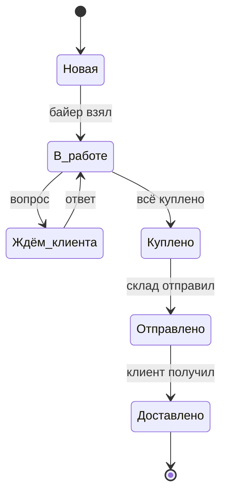

# Fitkit — рабочая программа сотрудника

19 ноября 2026 · Живая версия документа с комментариями: https://claude.ai/artifact/7y8TaGnefB8ZgFWDU5So63

Программа — это одно окно, где сотрудник Fitkit берёт заявку клиента, проверяет товары, выкупает их в магазинах, общается с клиентом и доводит заказ до отправки. Ниже — структура, функции, логика работы и макеты интерфейса для разработчиков.

## 1. Роли и задача программы

Главная задача — чтобы ни одна заявка не потерялась и сотрудник в каждый момент знал, что делать следующим. Программа — веб-приложение для компьютера (основной режим) с адаптивной версией для телефона: проверить статус и ответить клиенту можно в дороге.

| Роль             | Что делает в программе                                                        | Доступ                                   |
|------------------|-------------------------------------------------------------------------------|------------------------------------------|
| Байер (закупщик) | Берёт заявки, проверяет товары, выкупает их в магазинах, общается с клиентом  | Свои заказы + общая очередь новых заявок |
| Старший смены    | Распределяет заявки, разбирает проблемные заказы, одобряет возвраты и доплаты | Все заказы, отчёты по команде            |
| Склад / логист   | Принимает посылки из магазинов, сверяет, упаковывает, отправляет клиенту      | Заказы в статусах «Выкуплено» и дальше   |
| Администратор    | Настраивает статусы, шаблоны сообщений, магазины, права, курсы и комиссии     | Всё, включая настройки                   |

Клиент работает в своём приложении или боте Fitkit: присылает заявку, отвечает на вопросы, одобряет замену и оплачивает. В программе сотрудника он виден как карточка клиента и чат.

Дальше документ написан с точки зрения байера — основного пользователя.

## 2. Меню программы

В меню всего 5 пунктов — столько, сколько нужно байеру каждый день. Всё редкое (шаблоны, магазины, отчёты, настройки) спрятано в профиль внизу меню. Красный счётчик есть только у «Сообщений», чтобы не рассеивать внимание.

| Раздел    | Что внутри                                                                                      |
|-----------|-------------------------------------------------------------------------------------------------|
| Главная   | Список «Что сделать сейчас» и кнопка «Взять новую заявку» (раздел 3)                            |
| Заказы    | Все заказы сотрудника. Вверху — вкладки по статусам и переключатель «Мои / Все» (заказы коллег) |
| Сообщения | Все чаты с клиентами; каждый чат привязан к заказу                                              |
| Клиенты   | Контакты, адреса, размеры и история заказов                                                     |
| Посылки   | Всё, что в пути: из магазина на склад и со склада клиенту, с трек-номерами                      |

Поиск по номеру заказа, имени, телефону или трек-номеру — в разделе «Заказы».

## 3. Главная панель

Главная отвечает на один вопрос: «что мне сделать сейчас?» На ней только три части:

1.  **Кнопка «Взять новую заявку»** со счётчиком очереди. Система сама даёт самую старую заявку — выбирать не нужно.

2.  **Три числа:** нужно сделать сейчас · ждём ответа клиента · куплено сегодня.

3.  **Список «Что сделать сейчас».** Каждая строка — одно дело: что случилось простыми словами («Цена выросла на 640 ₽ — нужна доплата»), имя клиента, сколько времени осталось и **одна кнопка с глаголом**: «Напомнить», «Запросить доплату», «Купить», «Проверить». Просроченное — сверху, с красной полоской.

Отдельных блоков сообщений и статистики нет: новый ответ клиента сразу попадает в список дел. В список попадает заказ, если: клиент ответил; есть отметка «Проблема»; срок почти истёк или прошёл; заявку назначил старший; магазин больше 3 дней не присылает трек.

Макет главной (цифры в жёлтых кружках — пояснения):

## 4. Карточка заказа

Карточка — две колонки: слева товары, справа клиент. Над ними — плашка **«Сейчас»**: одной фразой что происходит с заказом и кнопка с нужным действием («Сейчас: ждём, какую замену выберет клиент» → «Напомнить клиенту»). Сотруднику не нужно разбираться в статусах — карточка сама говорит, что делать.

**Шапка:** номер заказа, имя клиента и 4 этапа: Проверка → Согласование → Покупка → Отправка. Пройденные — зелёные, текущий — цветной.

Как показывать то, что прислал клиент:

| Данные             | Где и как                                                                                     |
|--------------------|-----------------------------------------------------------------------------------------------|
| Фотографии одежды  | Слева в строке товара. По клику — во весь экран рядом с фото с сайта магазина, чтобы сравнить |
| Ссылки на магазины | Под названием: «zara.com ↗ открыть в магазине» — открывает товар в новой вкладке              |
| Размеры и цвета    | Одной строкой крупно: «L · белая · 3 999 ₽». Что не совпало — зачёркнуто                      |
| Адрес доставки     | Справа, с кнопкой «Копировать» — чтобы вставить на сайте магазина                             |
| Контакты           | Справа вверху: имя, мессенджер, телефон                                                       |
| Пожелания клиента  | Справа, на жёлтой плашке, дословно в кавычках                                                 |

**У каждого товара один понятный статус** справа в строке: зелёный «✓ Всё верно», оранжевый «Нет размера M — ждём клиента» или красный «Цена выше на 300 ₽» с кнопкой решения («Запросить доплату», «Предложить замену»). Всего три цвета, и каждый значит одно: зелёный — готово, оранжевый — ждём клиента, красный — нужно что-то сделать.

**Внизу — итог и одна большая кнопка следующего шага** («Перейти к покупке →»). Пока не все товары зелёные, она серая, и рядом написано почему: «Сначала решите 2 товара». На этапе покупки в строке товара появляются два поля: номер заказа в магазине и чек.

**Справа всегда одно и то же:** клиент, адрес, пожелание, чат. История действий и внутренние заметки спрятаны в меню «…» — они нужны редко.

Макет карточки заказа:

## 5. Рабочий процесс сотрудника

Заказ проходит 6 шагов; на каждом у сотрудника одна главная кнопка, а проблема с любым товаром уводит в согласование с клиентом и обратно. Схема — ниже, по шагам:

Расхождение при проверке уводит заказ к клиенту и обратно на проверку; дальше заказ идёт по прямой от байера к складу и клиенту.

1.  **Получить заявку.** Клиент отправляет заявку в боте или приложении — она попадает в «Заявки». Сотрудник нажимает «Взять следующую» (система даёт самую старую) или старший назначает её вручную. Клиент автоматически получает «Ваш байер — Анна, смотрим товары».

2.  **Проверить товары.** По каждой строке: открыть ссылку, сравнить с фото клиента, проверить размер, цвет, цену и наличие. Если клиент прислал только фото — найти товар и вставить ссылку. Всё совпало → «Отметить проверенным».

3.  **Согласовать расхождения** (если есть). Нет размера, цвета, товара или цена выросла → сотрудник предлагает замену, запрашивает доплату или уточнение (раздел 6). Заказ переходит в «Ждём клиента». Остальные товары можно выкупать, не дожидаясь ответа, если клиент не просил «только всё вместе».

4.  **Выкупить.** Товары сгруппированы по магазинам. Сотрудник открывает сайт кнопкой «Открыть в магазине ↗», кладёт товары в корзину, копирует адрес из карточки и оплачивает. Потом вносит номер заказа в магазине, фактическую цену и чек. Ошибка на оплате или товар исчез из корзины → «Сообщить о проблеме», заказ получает красную отметку «Проблема».

5.  **Отметить выкуп.** Кнопка «Отметить: выкуплено» активна, только когда у всех товаров заполнен номер заказа и цена (или товар убран с согласия клиента). Клиент получает уведомление и чеки.

6.  **Довести до отправки.** Трек-номера от магазинов вносятся вручную или из письма магазина → посылка приходит на склад → склад сверяет товар с карточкой и делает фото → упаковка → «Отправлено» с трек-номером для клиента. Заказ закрывается после доставки.

Правила, которые программа должна соблюдать сама:

- нельзя перейти к выкупу, пока есть непроверенные товары или неоплаченная доплата;

- если цена на сайте выше цены клиента больше чем на допуск (например, 3%; задаётся в настройках), товар требует согласования;

- при передаче заказа коллеге сотрудник оставляет обязательный комментарий «что сделано и что дальше»;

- каждое действие пишется в историю заказа: кто, что, когда.

## 6. Коммуникация с клиентом

Вся переписка идёт внутри заказа, а не в личных мессенджерах: так коллега может подхватить заказ, а спорные ситуации можно разобрать. Сообщения сотрудника уходят клиенту туда, откуда пришла заявка (бот, приложение), ответы клиента приходят в чат заказа.

Ключевой принцип — **вопрос с кнопками вместо свободного текста**. Клиент отвечает одним нажатием, и ответ сразу меняет товар и статус в карточке — сотруднику не нужно читать переписку и переносить данные вручную. Свободный чат остаётся для всего остального.

Три типа структурированных запросов:

| Запрос            | Когда                                                                      | Что видит клиент                                                             | Что происходит после ответа                                                      |
|-------------------|----------------------------------------------------------------------------|------------------------------------------------------------------------------|----------------------------------------------------------------------------------|
| Уточнение         | Нет размера в заявке, непонятное фото, несколько товаров под одной ссылкой | Вопрос + варианты ответа кнопками («S / M / L») или поле для ответа          | Ответ записывается в поле товара, заказ возвращается в «В обработке»             |
| Замена товара     | Нет размера, цвета или товара                                              | До 3 вариантов с фото, ценой и разницей + «Убрать товар» и «Написать байеру» | Выбранный вариант заменяет товар; если есть доплата — клиент сразу получает счёт |
| Доплата / возврат | Цена выросла, доставка магазина платная, товар убран                       | Сумма, причина, кнопки «Оплатить» / «Убрать товар»                           | После оплаты товар разблокируется для выкупа                                     |

**Как сотрудник согласует замену** (см. макет ниже):

1.  В строке товара нажимает «Предложить замену».

2.  Вставляет 1–3 ссылки на варианты — фото, цена и доплата подставятся сами. Пожелание клиента видно прямо в окне.

3.  Нажимает «Отправить клиенту». Что будет, если клиент не ответит за 24 ч, уже задано по умолчанию (товар уберём, деньги вернём) — менять это нужно редко.

4.  Клиент отвечает одной кнопкой → товар в заказе меняется сам, а дело появляется на главной у сотрудника.

**Сообщить о проблеме.** Кнопка в шапке заказа открывает форму: тип проблемы (товар закончился, магазин отменил заказ, не проходит оплата, посылка задерживается, пришёл дефектный или не тот товар, другое), товары, комментарий, фото. Дальше два флажка: «Сообщить клиенту» (с готовым текстом из шаблона) и «Позвать старшего». Заказ получает красную отметку «Проблема».

**Шаблоны ответов** с подстановками {имя}, {номер заказа}, {товар}, {сумма}: приветствие, нет размера, цена выросла, запрос фото, выкуплено, отправлено, задержка. Быстрые кнопки над полем ввода подбираются по статусу заказа. Внутренние заметки и упоминания коллег (@имя) клиент не видит.

Макет согласования замены — слева окно сотрудника, справа то, что видит клиент:

## 7. Статусы и уведомления

У заказа всего 6 статусов, и почти все ставятся сами — по действиям сотрудника и клиента. Цветов тоже мало: серый — всё идёт по плану, оранжевый — ждём клиента, красный — проблема, зелёный — готово.

Заказ идёт по прямой; единственная ветка — ожидание ответа клиента.

| Статус       | Что значит                                | Как попадает                  | Срок (предложение)              |
|--------------|-------------------------------------------|-------------------------------|---------------------------------|
| Новая        | Заявка в очереди                          | Клиент отправил заявку        | Взять за 30 мин                 |
| В работе     | Байер проверяет и покупает                | «Взять» или ответ клиента     | Проверить за 2 ч, купить за 4 ч |
| Ждём клиента | Клиенту отправлен вопрос, замена или счёт | Сотрудник отправил запрос     | 24 ч, напоминание через 12 ч    |
| Куплено      | Всё оплачено, посылки едут на склад       | Все товары куплены или убраны | Трек от магазина за 3 дня       |
| Отправлено   | У клиента есть трек-номер                 | Склад отправил и внёс трек    | По данным перевозчика           |
| Доставлено   | Заказ закрыт                              | Клиент получил посылку        | —                               |

Чего нет среди статусов — и почему:

- **«Проблема»** — не статус, а красная отметка. Она может появиться на любом шаге, статус при этом не меняется, а заказ сразу попадает в «Что сделать сейчас».

- **«На складе»** — видно в разделе «Посылки»; для байера заказ всё ещё «Куплено».

- **«Отменён»** — заказ уходит в архив и пропадает из рабочих списков.

У товара статусы ещё проще: всё верно · ждём клиента · нужно решить · куплен · убран.

Уведомления — кому и когда:

| Событие                                     | Байер                                                        | Клиент                               | Старший смены                 |
|---------------------------------------------|--------------------------------------------------------------|--------------------------------------|-------------------------------|
| Новая заявка                                | Счётчик в меню; если назначена ему — всплывающее уведомление | «Заявка принята, номер \#…»          | Если никто не взял за 30 мин  |
| Заявка взята в работу                       | —                                                            | «Ваш байер — {имя}»                  | —                             |
| Клиент написал или ответил кнопкой          | Всплывающее + звук + «Что сделать сейчас»                    | —                                    | —                             |
| Запрос клиенту (уточнение, замена, доплата) | —                                                            | Сообщение с кнопками ответа          | —                             |
| Клиент молчит 12 ч / 24 ч                   | В 24 ч — «Что сделать сейчас»                                | В 12 ч — напоминание                 | —                             |
| Срок статуса почти истёк (25% времени)      | Жёлтый таймер                                                | —                                    | —                             |
| Срок нарушен                                | Красный таймер + уведомление                                 | —                                    | Уведомление                   |
| Проблема отмечена                           | —                                                            | Если стоит флажок «Сообщить клиенту» | Если стоит «Позвать старшего» |
| Выкуплено                                   | —                                                            | «Всё куплено» + чеки                 | —                             |
| Отправлено                                  | —                                                            | Трек-номер и ссылка на отслеживание  | —                             |
| Посылка застряла (нет движения 5 дней)      | «Что сделать сейчас» + отметка в «Посылках»                  | —                                    | —                             |

Каналы: для сотрудника — внутри программы (колокольчик, счётчики, звук) и пуш в браузере; для клиента — тот канал, через который он прислал заявку. Уведомления не приходят сотруднику в режиме «Перерыв», клиенту — ночью (с 22:00 до 9:00 по его времени).

## 8. Аналоги: что взять у существующих сервисов

Готовой программы «под ключ» для такого сервиса нет: Fitkit совмещает личного закупщика, службу поддержки и логистику. Но у трёх групп сервисов есть проверенные решения, которые стоит перенять.

| Сервис                                                                                                              | Что это                                              | Что взять в Fitkit                                                                                                                                                                                                                                                                                                                                     |
|---------------------------------------------------------------------------------------------------------------------|------------------------------------------------------|--------------------------------------------------------------------------------------------------------------------------------------------------------------------------------------------------------------------------------------------------------------------------------------------------------------------------------------------------------|
| [Instacart](https://docs.instacart.com/connect/post-checkout_guide/concepts/replacement_flow) (приложение сборщика) | Сборщик покупает продукты за клиента в магазине      | Сценарий замены: сборщик предлагает замену, клиент нажимает «Одобрить» или «Вернуть деньги»; если не ответил до кассы — замена покупается. Ответ клиента [сразу обновляет список покупок](https://company.instacart.com/shopper-community/providing-a-more-straightforward-replacements-experience), чат остаётся для остального. Это основа раздела 6 |
| Сервисы-агенты Superbuy, [Sugargoo](https://blog.sugargoo.com/?p=14031)                                             | Выкуп товаров с китайских площадок по ссылке клиента | Контроль качества на складе: склад делает 3–5 фото товара, клиент видит их до отправки и может запросить возврат или обмен. В Fitkit — статус «На складе» с фото и статус товара «Брак / возврат»                                                                                                                                                      |
| Посредники с складом: Shopfans, USmall и др. ([обзор Т—Ж](https://t-j.ru/posredniki/))                              | Склад за рубежом + пересылка клиенту                 | Консолидация: несколько посылок из разных магазинов ждут на складе и уходят одной отправкой. Раздел «Отслеживание» с двумя ногами пути: магазин → склад и склад → клиент                                                                                                                                                                               |
| [Zendesk](https://support.zendesk.com/hc/en-us/articles/5604663490458-Using-SLA-policies)                           | Система обработки обращений поддержки                | Сроки (SLA) с таймером в списках и сортировкой по оставшемуся времени; [представления «скоро нарушится срок»](https://support.zendesk.com/hc/en-us/articles/4408834732954); макросы — шаблоны ответов с подстановкой полей. Это основа блока «Что сделать сейчас» и шаблонов                                                                           |
| RetailCRM, amoCRM                                                                                                   | CRM для интернет-магазинов и продаж                  | Настраиваемые статусы заказа и [автосообщения клиенту при смене статуса](https://oborot.ru/news/status-zakaza-mozhno-otpravit-klientu-v-socset-i80054.html); карточка клиента с историей заказов; вкладки по статусам в разделе «Заказы»                                                                                                               |
| Trello, Jira                                                                                                        | Доски задач                                          | Доска заказов по статусам с перетаскиванием карточек и фильтрами — второй вид раздела «Заказы» (по желанию)                                                                                                                                                                                                                                            |
| Intercom, Jivo                                                                                                      | Единый инбокс чатов из разных каналов                | Одна лента сообщений из бота, приложения и почты; внутренние заметки и @упоминания коллег в том же чате                                                                                                                                                                                                                                                |

Из этого следует рекомендация по реализации: на старте можно не писать всё с нуля — чат и рассылки клиентам строить на готовом сервисе (Telegram Bot API или аналоге), а своими силами делать карточку заказа, статусы и главную панель — именно их нет в готовых системах.

Описания функций — по публичным материалам сервисов (ссылки в таблице); правила и тарифы этих сервисов меняются, перед интеграцией стоит перепроверить.

## 9. Для разработчиков

**Основные сущности данных**

| Сущность              | Ключевые поля                                                                                                                                                               |
|-----------------------|-----------------------------------------------------------------------------------------------------------------------------------------------------------------------------|
| Клиент                | имя, телефон, мессенджер + id чата, e-mail, предпочитаемый канал, часовой пояс, мерки и размеры, адреса (список), внутренние заметки                                        |
| Заказ                 | номер, клиент, байер, статус, дедлайн статуса, «нужно до», адрес доставки (копия на момент заказа), пожелания, суммы (товары, комиссия, оплачено, разница), источник заявки |
| Товар (строка заказа) | ссылка, магазин, название, фото клиента, фото с сайта, размер, цвет, количество, цена клиента, цена на сайте, фактическая цена, статус товара, чек-лист, пожелание к товару |
| Выкуп                 | магазин, товары, номер заказа в магазине, сумма, валюта, способ оплаты, чек (файл), трек от магазина                                                                        |
| Запрос клиенту        | тип (уточнение / замена / доплата), товар, варианты, срок ответа, правило при молчании, ответ и время ответа                                                                |
| Сообщение             | заказ, автор, канал, текст, вложения, внутреннее или клиентское, статус доставки и прочтения                                                                                |
| Отправка              | товары, перевозчик, трек-номер, вес, фото упаковки, события отслеживания                                                                                                    |
| Магазин               | домен, аккаунт, способ оплаты, сроки, таблица размеров, условия возврата, заметки                                                                                           |
| Событие истории       | заказ, кто, что сделал, старое и новое значение, время                                                                                                                      |

**Интеграции**

- Канал заявок и чата с клиентом (бот в мессенджере и/или клиентское приложение): входящие заявки, сообщения в обе стороны, сообщения с кнопками ответа.

- Разбор ссылки на товар: название, фото, цена, наличие размеров (Open Graph, разметка товара schema.org, для крупных магазинов — отдельные парсеры). Если разобрать не удалось, поля заполняются вручную.

- Оплата для клиента: счёт на доплату, статус оплаты, возврат.

- Отслеживание посылок по трек-номеру (агрегатор трекинга или API перевозчиков).

- Курсы валют — если магазины зарубежные.

**Требования без функций**

- Работа в реальном времени: новые сообщения и смена статуса появляются без перезагрузки страницы.

- Два сотрудника не могут взять одну заявку: «Взять» — атомарная операция.

- Контакты клиента частично скрыты (как на макете), полные данные — по кнопке «Копировать», каждый просмотр пишется в историю. Данные карт и пароли от аккаунтов магазинов в программе не хранятся — только в менеджере паролей компании.

- Персональные данные хранятся по требованиям закона страны работы (для России — 152-ФЗ).

- Интерфейс рассчитан на экран от 1366 px; списки, карточка и чат работают на телефоне.

**Этапы разработки**

| Этап        | Что входит                                                                                                                                                                   |
|-------------|------------------------------------------------------------------------------------------------------------------------------------------------------------------------------|
| MVP         | Заявки и «Взять», карточка заказа с товарами и чек-листом, статусы заказа и товара, чат с клиентом, запрос замены с кнопками, главная с «Что сделать сейчас», история заказа |
| Второй этап | Таймеры сроков и автонапоминания, шаблоны ответов, разбор ссылок, доска по статусам, справочник магазинов, доплаты и возвраты                                                |
| Третий этап | Отслеживание посылок, склад (приёмка, фото, упаковка), отчёты, мобильная версия                                                                                              |

## 10. Открытые вопросы к бизнесу

Ответы на эти вопросы меняют детали выше; в документе взяты разумные значения по умолчанию.

- Откуда приходят заявки — бот, приложение, сайт? От этого зависит канал чата и формат заявки.

- Магазины российские, зарубежные или и те, и другие? Нужны ли валюты, склад за рубежом и таможня?

- Клиент платит до выкупа (предоплата) или после проверки товаров? Как считается комиссия?

- Посылки идут через склад Fitkit или магазин везёт прямо клиенту? Во втором случае статус «На складе» не нужен.

- Какой срок ответа клиенту обещает Fitkit и в какие часы работают байеры? От этого зависят таймеры из раздела 7.

- Сколько байеров и заявок в день ожидается? Нужен ли старший смены с первого дня или заявки разбираются сами?

- Какой допуск по цене сотрудник может принять сам, без согласования с клиентом (в документе — 3%)?

---

## Файлы макетов

- `mockups/*.html` — исходники макетов (HTML + `styles.css`), открываются в браузере.
- `mockups/png/*.png` — картинки макетов.
- `mockups/render.js` — пересобрать картинки: `node mockups/render.js` (нужен Playwright).
