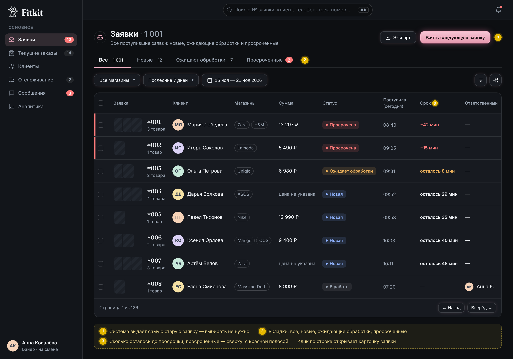
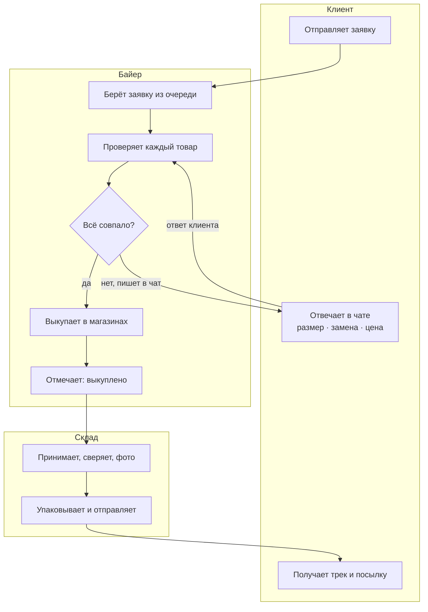
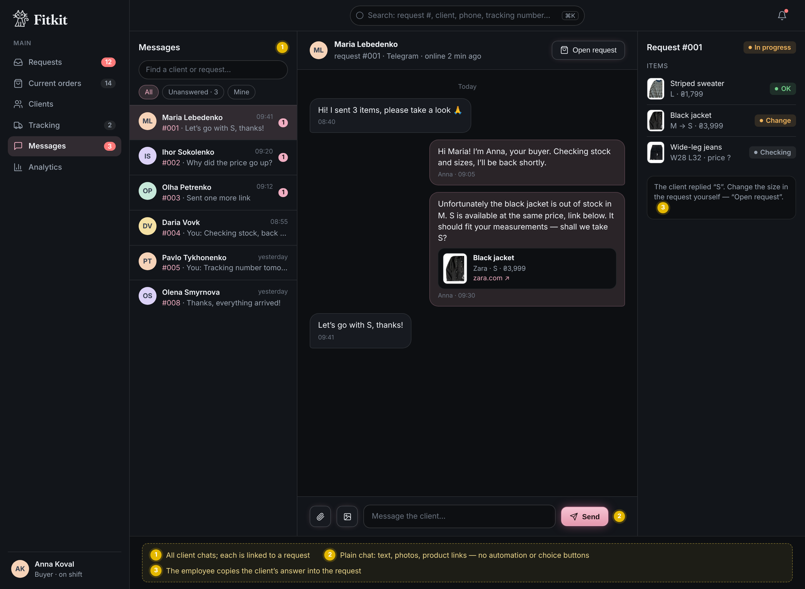
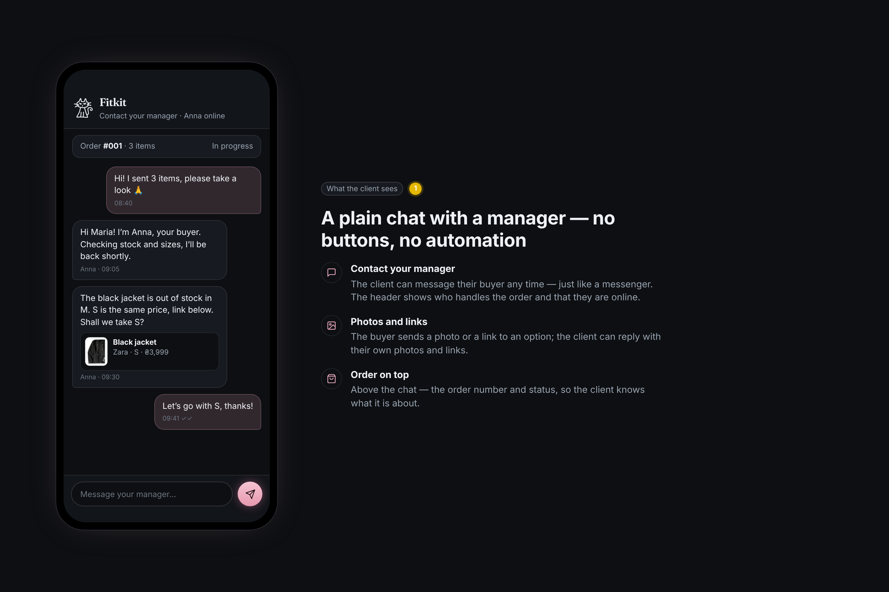
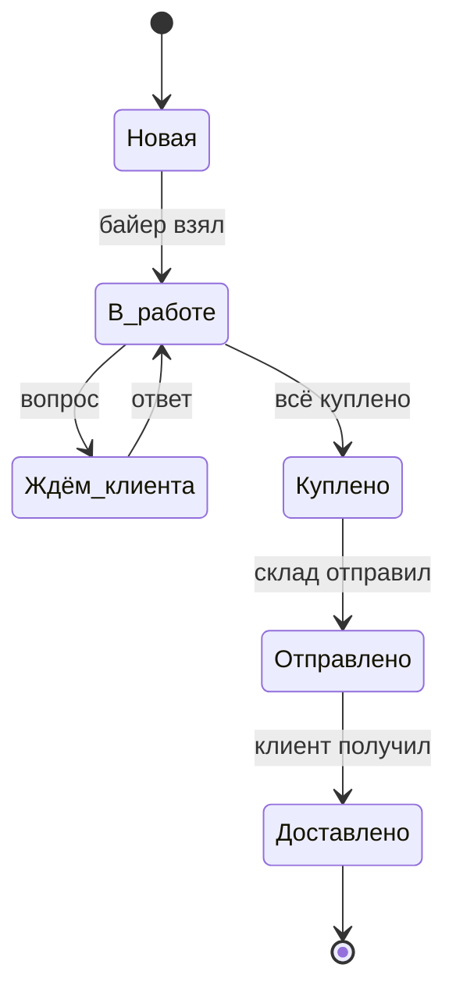

# Fitkit — рабочая программа сотрудника

19 ноября 2026 · Живая версия документа с комментариями: https://claude.ai/artifact/7y8TaGnefB8ZgFWDU5So63

Программа — это одно окно, где сотрудник Fitkit берёт заявку клиента, проверяет товары, выкупает их в магазинах, общается с клиентом и доводит заказ до отправки. Ниже — структура, функции, логика работы и макеты интерфейса для разработчиков.

## 1. Роли и задача программы

Главная задача — чтобы ни одна заявка не потерялась и сотрудник в каждый момент знал, что делать следующим. Программа — веб-приложение для компьютера (основной режим) с адаптивной версией для телефона: проверить статус и ответить клиенту можно в дороге.

| Роль             | Что делает в программе                                                        | Доступ                                   |
|------------------|-------------------------------------------------------------------------------|------------------------------------------|
| Байер (закупщик) | Берёт заявки, проверяет товары, выкупает их в магазинах, общается с клиентом  | Свои заказы + общая очередь новых заявок |
| Старший смены    | Распределяет заявки, разбирает проблемные заказы, одобряет возвраты и доплаты | Все заказы, отчёты по команде            |
| Склад / логист   | Принимает посылки из магазинов, сверяет, упаковывает, отправляет клиенту      | Заказы в статусах «Выкуплено» и дальше   |
| Администратор    | Настраивает статусы, шаблоны сообщений, магазины, права, курсы и комиссии     | Всё, включая настройки                   |

Клиент работает в своём приложении или боте Fitkit: присылает заявку, отвечает на вопросы, одобряет замену и оплачивает. В программе сотрудника он виден как карточка клиента и чат.

Дальше документ написан с точки зрения байера — основного пользователя.

## 2. Меню программы

В меню 6 разделов — левая панель с логотипом Fitkit сверху и профилем сотрудника внизу. Вверху экрана — поиск (номер заявки, клиент, телефон, трек-номер) и колокольчик уведомлений.

| Раздел         | Что внутри                                                                                                                                                                                                     |
|----------------|----------------------------------------------------------------------------------------------------------------------------------------------------------------------------------------------------------------|
| Заявки         | Все поступившие заявки. Вкладки: все · новые (только пришли, никто не взял) · ожидающие обработки (срок почти истёк, клиент дополнил заявку или коллега вернул её в очередь) · просроченные (не взяты вовремя) |
| Текущие заказы | Заказы, которые сотрудники уже обрабатывают. Фильтр «Мои / Все» и по статусу                                                                                                                                   |
| Клиенты        | Контактные данные, история заказов, адреса, предпочтения (размеры, любимые магазины, что не нравится)                                                                                                          |
| Отслеживание   | Оформленные покупки, трек-номера, доставка и проблемы в пути (нет трека, посылка застряла)                                                                                                                     |
| Сообщения      | Общение с клиентами: уточнение размеров, замен и других деталей. Каждый чат привязан к заказу                                                                                                                  |
| Аналитика      | Количество заявок, скорость обработки, ошибки и проблемы, эффективность сотрудников. Байер видит свои цифры, старший — по всей команде                                                                         |

Заявка переходит из «Заявок» в «Текущие заказы», когда сотрудник берёт её в работу, и в «Отслеживание» — когда всё куплено.

**Раздел «Текущие заказы»** — доска по статусам (или обычная таблица, переключатель сверху):

1.  **Четыре колонки:** В работе · Ждём клиента · Куплено · Отправлено. Перетащил карточку в другую колонку — статус сменился (те же правила, что и у кнопок в карточке заявки).
2.  **Карточка заказа:** фото вещей, номер, сколько времени осталось или сколько ждём, клиент, товары и сумма (для купленных — где посылка), непрочитанные сообщения и ответственный. Проблема — красная плашка на карточке, ожидание ответа — оранжевая.
3.  **Фильтры:** «Мои / Все» (все — для старшего смены), магазин, «Только с проблемами», сортировка по сроку. Клик по карточке открывает карточку заявки.

**Раздел «Аналитика»** — один экран за выбранный период (по умолчанию 7 дней) с кнопкой «Экспорт»:

1.  **Четыре главные цифры** с сравнением с прошлым периодом: заявок за период, среднее время обработки (от заявки до «Куплено»), доля просроченных, число ошибок и проблем.
2.  **Заявки по дням** — столбики, самый загруженный день выделен (помогает планировать смены).
3.  **Скорость обработки** — линия среднего времени по дням и пунктир цели (например, 2 ч).
4.  **Ошибки и проблемы по типам** — самая частая причина подсвечена, под графиком — короткий вывод.
5.  **Эффективность сотрудников** — таблица: заявок, среднее время, доля просрочек, ошибки. Байер видит только свою строку, старший смены — всю команду.

Цифры на макете — пример для расположения, не реальные данные.

**Раздел «Клиенты»** — слева список с поиском (имя, телефон, Telegram, номер заказа), справа профиль выбранного клиента:

1.  **Шапка:** имя, с какого времени клиент и кто его ведёт, кнопки «Написать» и «Открыть текущую заявку»; четыре цифры — заказов, всего потрачено, средний чек, возвратов.
2.  **Контакты:** Telegram, телефон, e-mail; основной канал отмечен, телефон скрыт до клика «Показать».
3.  **Адреса доставки:** несколько, один — «по умолчанию», с подробностями (курьер, пункт выдачи, подъезд, время).
4.  **Предпочтения:** размеры (верх, низ, обувь), любимые магазины, цвета и что клиенту не нравится. Байер видит это при каждой заявке и не переспрашивает. Рядом — заметки сотрудников.
5.  **История заказов:** фото вещей, номер, магазины, сумма, статус и дата.

**Раздел «Отслеживание»** — все оформленные покупки в пути:

1.  **Четыре счётчика:** едут из магазинов на склад · на складе · едут к клиентам · проблемы (красный). Те же группы — вкладками над таблицей.
2.  **Таблица посылок:** фото и номер заказа, магазин и перевозчик, трек-номер, этап (5 точек: оформлено → в пути → склад → к клиенту → доставлено), последнее событие. Проблемные строки (нет трека больше 3 дней, нет движения больше 5 дней) — с красной полосой и красным текстом.
3.  **Панель посылки справа** (по клику на строку): товар и клиент, трек-номер с кнопкой «Копировать», путь посылки по событиям и следующее действие («Отправить →» или «Написать клиенту»).

## 3. Первый экран: список заявок

После входа сотрудник сразу попадает в «Заявки»: над списком — общее число («Заявки · 1 001»), ниже — таблица, одна строка на заявку.

1.  **Шапка:** название и число, кнопки «Экспорт» и «Взять следующую заявку» (система даёт самую старую).

2.  **Вкладки:** Все · Новые · Ожидают обработки · Просроченные, у каждой счётчик; у просроченных он красный.

3.  **Фильтры:** магазин, период, даты, сортировка.

4.  **Строка заявки:** миниатюры фото товаров и номер (#001), число товаров, клиент, магазины, сумма (или «цена не указана»), статус, время поступления, таймер до просрочки и ответственный. Просроченные — сверху, с красной полосой слева.

5.  **Клик по строке** открывает карточку заявки (раздел 4). Внизу — страницы.

Макет списка заявок (цифры в жёлтых кружках — пояснения):

## 4. Карточка заявки

По клику на заявку открывается карточка из двух колонок: **слева — что прислал клиент, справа — управление заказом**. В шапке — номер заявки, статус, когда и откуда поступила, кнопки «Написать клиенту» и «Передать коллеге».

**Левая колонка — товары.** Каждый товар — отдельный блок:

- фото клиента (по клику — на весь экран рядом с фото с сайта), название и магазин;

- **размер**, **количество**, **цена, если она известна** (иначе серым «не указана» и пункт в списке проблем);

- **комментарий клиента** — дословно, на бежевой плашке;

- статус товара (проверен / проверяется / нет размера и т. д.);

- обязательная кнопка **«Открыть в магазине ↗»** — страница товара в новой вкладке; если есть проблема — ещё «Написать клиенту».

Ниже товаров — блоки «Клиент и доставка» (имя, контакты, адрес с кнопкой «Копировать») и «История» (что происходило с заявкой, кто и когда).

**Правая колонка — управление заказом:**

| Блок                     | Что показывает                                                                                                                      |
|--------------------------|-------------------------------------------------------------------------------------------------------------------------------------|
| Текущий статус           | Статус, с какого времени и сколько осталось до просрочки                                                                            |
| Ответственный сотрудник  | Имя и роль, кнопка «Сменить»                                                                                                        |
| Общая стоимость          | Товары с известной ценой, товары с ценой «уточняется», комиссия, итого                                                              |
| Кнопки изменения статуса | Следующий шаг — большой розовой кнопкой («Перевести в «Куплено» →»), рядом «Ждём клиента», «Проблема» и «Отменить заказ»            |
| Ошибки и проблемы        | Список: что не так и с каким товаром; красным — мешает покупке, оранжевым — нужно уточнить. Кнопка «Спросить клиента» открывает чат |
| Комментарии сотрудников  | Внутренние заметки с автором и временем и поле для нового; клиент их не видит                                                       |

Кнопка «Перевести в «Куплено»» не сработает, пока в списке есть красные проблемы — программа покажет, какие именно.

Макет карточки заявки:

## 5. Рабочий процесс сотрудника

Заказ проходит 6 шагов; на каждом у сотрудника одна главная кнопка, а проблема с любым товаром уводит в согласование с клиентом и обратно. Схема — ниже, по шагам:

Расхождение при проверке уводит заказ к клиенту и обратно на проверку; дальше заказ идёт по прямой от байера к складу и клиенту.

1.  **Получить заявку.** Клиент отправляет заявку в боте или приложении — она попадает в «Заявки». Сотрудник нажимает «Взять следующую» (система даёт самую старую) или старший назначает её вручную. Клиент автоматически получает «Ваш байер — Анна, смотрим товары».

2.  **Проверить товары.** По каждой строке: открыть ссылку, сравнить с фото клиента, проверить размер, цвет, цену и наличие. Если клиент прислал только фото — найти товар и вставить ссылку. Всё совпало → «Отметить проверенным».

3.  **Согласовать расхождения** (если есть). Нет размера, цвета, товара или цена выросла → сотрудник пишет клиенту в чат и спрашивает, как быть (раздел 6). Заказ переходит в «Ждём клиента». Остальные товары можно выкупать, не дожидаясь ответа, если клиент не просил «только всё вместе».

4.  **Выкупить.** Товары сгруппированы по магазинам. Сотрудник открывает сайт кнопкой «Открыть в магазине ↗», кладёт товары в корзину, копирует адрес из карточки и оплачивает. Потом вносит номер заказа в магазине, фактическую цену и чек. Ошибка на оплате или товар исчез из корзины → «Сообщить о проблеме», заказ получает красную отметку «Проблема».

5.  **Отметить выкуп.** Кнопка «Отметить: выкуплено» активна, только когда у всех товаров заполнен номер заказа и цена (или товар убран с согласия клиента). Клиент получает уведомление и чеки.

6.  **Довести до отправки.** Трек-номера от магазинов вносятся вручную или из письма магазина → посылка приходит на склад → склад сверяет товар с карточкой и делает фото → упаковка → «Отправлено» с трек-номером для клиента. Заказ закрывается после доставки.

Правила, которые программа должна соблюдать сама:

- нельзя перейти к выкупу, пока есть непроверенные товары или неоплаченная доплата;

- если цена на сайте выше цены клиента больше чем на допуск (например, 3%; задаётся в настройках), товар требует согласования;

- при передаче заказа коллеге сотрудник оставляет обязательный комментарий «что сделано и что дальше»;

- каждое действие пишется в историю заказа: кто, что, когда.

## 6. Коммуникация с клиентом

Общение с клиентом — **обычный чат, без автоматики и кнопок выбора**. Если нет размера, цвета, выросла цена или что-то непонятно, сотрудник просто пишет клиенту и спрашивает. Клиент отвечает менеджеру так же, как в мессенджере.

**У сотрудника — раздел «Сообщения»** из трёх колонок:

1.  Список чатов: клиент, номер заявки, последнее сообщение, счётчик непрочитанных. Фильтры «Все», «Без ответа», «Мои» и поиск.

2.  Переписка: текст, фото и ссылки на товары (ссылка показывается карточкой с фото и ценой). Внизу — поле ввода, скрепка, фото и «Отправить».

3.  Краткая заявка справа: товары со статусами и кнопка «Открыть заявку».

Из карточки заявки в чат ведут кнопки «Написать клиенту» (в шапке и у товара с проблемой) и «Спросить клиента» в списке проблем.

**Как решается вопрос с размером (или любой другой):**

1.  Сотрудник пишет клиенту в чат своими словами, при нужде прикладывает ссылку или фото варианта.

2.  Сам ставит статус «Ждём клиента», если без ответа дальше идти нельзя.

3.  Клиент отвечает — чат поднимается наверх, у сотрудника появляется уведомление.

4.  Сотрудник сам переносит ответ в заявку (меняет размер, товар, цену) и возвращает статус «В работе».

**У клиента — «Связь с менеджером».** В боте или приложении клиент видит обычную переписку со своим байером: в шапке — кто его ведёт и онлайн ли он, над перепиской — номер заказа и статус, внизу — поле «Написать менеджеру». Никаких кнопок выбора — клиент просто отвечает текстом, фото или ссылкой. Клиент может написать первым в любой момент.

**Сообщить о проблеме.** Для внутренних проблем (не проходит оплата, магазин отменил заказ, посылка задерживается) сотрудник ставит красную отметку «Проблема» с комментарием и при нужде зовёт старшего через «Комментарии сотрудников» (@имя). Клиенту сообщают об этом тоже обычным сообщением в чате.

Макет чата у сотрудника:

Что видит клиент:

## 7. Статусы и уведомления

У заказа всего 6 статусов, и почти все ставятся сами — по действиям сотрудника и клиента. Цветов тоже мало: серый — всё идёт по плану, оранжевый — ждём клиента, красный — проблема, зелёный — готово.

Заказ идёт по прямой; единственная ветка — ожидание ответа клиента.

| Статус       | Что значит                                     | Как попадает                  | Срок (предложение)                    |
|--------------|------------------------------------------------|-------------------------------|---------------------------------------|
| Новая        | Заявка в очереди                               | Клиент отправил заявку        | Взять за 30 мин                       |
| В работе     | Байер проверяет и покупает                     | «Взять» или ответ клиента     | Проверить за 2 ч, купить за 4 ч       |
| Ждём клиента | Сотрудник спросил клиента в чате и ждёт ответа | Сотрудник ставит сам          | 24 ч, дальше напомнить в чате вручную |
| Куплено      | Всё оплачено, посылки едут на склад            | Все товары куплены или убраны | Трек от магазина за 3 дня             |
| Отправлено   | У клиента есть трек-номер                      | Склад отправил и внёс трек    | По данным перевозчика                 |
| Доставлено   | Заказ закрыт                                   | Клиент получил посылку        | —                                     |

Чего нет среди статусов — и почему:

- **«Проблема»** — не статус, а красная отметка. Она может появиться на любом шаге, статус при этом не меняется, а заказ поднимается наверх списка «Текущие заказы», а проблема попадает в блок «Ошибки и проблемы» карточки.

- **«На складе»** — видно в разделе «Отслеживание»; для байера заказ всё ещё «Куплено».

- **«Отменён»** — заказ уходит в архив и пропадает из рабочих списков.

У товара статусы ещё проще: всё верно · ждём клиента · нужно решить · куплен · убран.

Уведомления — кому и когда:

| Событие                                | Байер                                                        | Клиент                                | Старший смены                 |
|----------------------------------------|--------------------------------------------------------------|---------------------------------------|-------------------------------|
| Новая заявка                           | Счётчик в меню; если назначена ему — всплывающее уведомление | «Заявка принята, номер \#…»           | Если никто не взял за 30 мин  |
| Заявка взята в работу                  | —                                                            | «Ваш байер — {имя}»                   | —                             |
| Клиент написал в чат                   | Всплывающее + звук + «Текущие заказы»                        | —                                     | —                             |
| Сотрудник написал клиенту              | —                                                            | Сообщение в чате «Связь с менеджером» | —                             |
| Клиент молчит 24 ч                     | В 24 ч — «Текущие заказы»                                    | — (байер напишет сам)                 | —                             |
| Срок статуса почти истёк (25% времени) | Жёлтый таймер                                                | —                                     | —                             |
| Срок нарушен                           | Красный таймер + уведомление                                 | —                                     | Уведомление                   |
| Проблема отмечена                      | —                                                            | Если стоит флажок «Сообщить клиенту»  | Если стоит «Позвать старшего» |
| Выкуплено                              | —                                                            | «Всё куплено» + чеки                  | —                             |
| Отправлено                             | —                                                            | Трек-номер и ссылка на отслеживание   | —                             |
| Посылка застряла (нет движения 5 дней) | «Отслеживание» + красная отметка у заказа                    | —                                     | —                             |

Каналы: для сотрудника — внутри программы (колокольчик, счётчики, звук) и пуш в браузере; для клиента — тот канал, через который он прислал заявку. Уведомления не приходят сотруднику в режиме «Перерыв», клиенту — ночью (с 22:00 до 9:00 по его времени).

## 8. Аналоги: что взять у существующих сервисов

Готовой программы «под ключ» для такого сервиса нет: Fitkit совмещает личного закупщика, службу поддержки и логистику. Но у трёх групп сервисов есть проверенные решения, которые стоит перенять.

| Сервис                                                                                                              | Что это                                              | Что взять в Fitkit                                                                                                                                                                                                                                                                                                                                                                                 |
|---------------------------------------------------------------------------------------------------------------------|------------------------------------------------------|----------------------------------------------------------------------------------------------------------------------------------------------------------------------------------------------------------------------------------------------------------------------------------------------------------------------------------------------------------------------------------------------------|
| [Instacart](https://docs.instacart.com/connect/post-checkout_guide/concepts/replacement_flow) (приложение сборщика) | Сборщик покупает продукты за клиента в магазине      | Сценарий замены: сборщик предлагает замену, клиент нажимает «Одобрить» или «Вернуть деньги»; если не ответил до кассы — замена покупается. Ответ клиента [сразу обновляет список покупок](https://company.instacart.com/shopper-community/providing-a-more-straightforward-replacements-experience), чат остаётся для остального. В Fitkit решили проще — обычный чат без кнопок выбора (раздел 6) |
| Сервисы-агенты Superbuy, [Sugargoo](https://blog.sugargoo.com/?p=14031)                                             | Выкуп товаров с китайских площадок по ссылке клиента | Контроль качества на складе: склад делает 3–5 фото товара, клиент видит их до отправки и может запросить возврат или обмен. В Fitkit — статус «На складе» с фото и статус товара «Брак / возврат»                                                                                                                                                                                                  |
| Посредники с складом: Shopfans, USmall и др. ([обзор Т—Ж](https://t-j.ru/posredniki/))                              | Склад за рубежом + пересылка клиенту                 | Консолидация: несколько посылок из разных магазинов ждут на складе и уходят одной отправкой. Раздел «Отслеживание» с двумя ногами пути: магазин → склад и склад → клиент                                                                                                                                                                                                                           |
| [Zendesk](https://support.zendesk.com/hc/en-us/articles/5604663490458-Using-SLA-policies)                           | Система обработки обращений поддержки                | Сроки (SLA) с таймером в списках и сортировкой по оставшемуся времени; [представления «скоро нарушится срок»](https://support.zendesk.com/hc/en-us/articles/4408834732954); макросы — шаблоны ответов с подстановкой полей. Это основа блока «Просроченные» и шаблонов                                                                                                                             |
| RetailCRM, amoCRM                                                                                                   | CRM для интернет-магазинов и продаж                  | Настраиваемые статусы заказа и [автосообщения клиенту при смене статуса](https://oborot.ru/news/status-zakaza-mozhno-otpravit-klientu-v-socset-i80054.html); карточка клиента с историей заказов; вкладки по статусам в разделе «Заказы»                                                                                                                                                           |
| Trello, Jira                                                                                                        | Доски задач                                          | Доска заказов по статусам с перетаскиванием карточек и фильтрами — второй вид раздела «Заказы» (по желанию)                                                                                                                                                                                                                                                                                        |
| Intercom, Jivo                                                                                                      | Единый инбокс чатов из разных каналов                | Одна лента сообщений из бота, приложения и почты; внутренние заметки и @упоминания коллег в том же чате                                                                                                                                                                                                                                                                                            |

Из этого следует рекомендация по реализации: на старте можно не писать всё с нуля — чат и рассылки клиентам строить на готовом сервисе (Telegram Bot API или аналоге), а своими силами делать карточку заказа, статусы и главную панель — именно их нет в готовых системах.

Описания функций — по публичным материалам сервисов (ссылки в таблице); правила и тарифы этих сервисов меняются, перед интеграцией стоит перепроверить.

## 9. Для разработчиков

**Фирменный стиль — как на сайте [fitkit.space](https://fitkit.space/for-brands)**

| Элемент          | Значение                                                                                                                                                                                                      |
|------------------|---------------------------------------------------------------------------------------------------------------------------------------------------------------------------------------------------------------|
| Тема             | Тёмная — на основе тёмного режима сайта. Светлая тема («бумага» \#faf8f5) — по желанию сотрудника в настройках                                                                                                |
| Логотип          | Кот-эмблема (на тёмном фоне — белая) + надпись «Fitkit» шрифтом Fraunces, 600                                                                                                                                 |
| Фон              | \#0d0f12 — страница, \#12151a — меню и верхняя панель, \#171a20 — карточки                                                                                                                                    |
| Текст            | \#eef1f5 основной, \#99a3b0 вторичный                                                                                                                                                                         |
| Акцент           | Розовый \#f0aec2 — главные кнопки (тёмный текст на розовом), ссылки, активный пункт меню, иконки                                                                                                              |
| Подсветка кнопок | Главные — мягкое розовое свечение `box-shadow: 0 0 18px -2px rgba(255,132,178,.55)`; обычные — едва заметное `0 0 14px -6px rgba(240,174,194,.45)`; «Отменить» — красное. При наведении свечение чуть сильнее |
| Шрифты           | Inter — весь интерфейс; Fraunces — логотип и номера заявок (в Fraunces нет кириллицы, поэтому русские заголовки — Inter)                                                                                      |
| Форма            | Скругления 10–14 px, тонкие рамки rgba(238,241,245,.10), иконки в круглых плашках, поиск-«таблетка»                                                                                                           |

**Основные сущности данных**

| Сущность              | Ключевые поля                                                                                                                                                               |
|-----------------------|-----------------------------------------------------------------------------------------------------------------------------------------------------------------------------|
| Клиент                | имя, телефон, мессенджер + id чата, e-mail, предпочитаемый канал, часовой пояс, мерки и размеры, адреса (список), внутренние заметки                                        |
| Заказ                 | номер, клиент, байер, статус, дедлайн статуса, «нужно до», адрес доставки (копия на момент заказа), пожелания, суммы (товары, комиссия, оплачено, разница), источник заявки |
| Товар (строка заказа) | ссылка, магазин, название, фото клиента, фото с сайта, размер, цвет, количество, цена клиента, цена на сайте, фактическая цена, статус товара, чек-лист, пожелание к товару |
| Выкуп                 | магазин, товары, номер заказа в магазине, сумма, валюта, способ оплаты, чек (файл), трек от магазина                                                                        |
| Чат заявки            | заявка, клиент, ответственный, число непрочитанных, время последнего ответа                                                                                                 |
| Сообщение             | заказ, автор, канал, текст, вложения, внутреннее или клиентское, статус доставки и прочтения                                                                                |
| Отправка              | товары, перевозчик, трек-номер, вес, фото упаковки, события отслеживания                                                                                                    |
| Магазин               | домен, аккаунт, способ оплаты, сроки, таблица размеров, условия возврата, заметки                                                                                           |
| Событие истории       | заказ, кто, что сделал, старое и новое значение, время                                                                                                                      |

**Интеграции**

- Канал заявок и чата с клиентом (бот в мессенджере и/или клиентское приложение): входящие заявки, сообщения в обе стороны, фото и ссылки в чате.

- Разбор ссылки на товар: название, фото, цена, наличие размеров (Open Graph, разметка товара schema.org, для крупных магазинов — отдельные парсеры). Если разобрать не удалось, поля заполняются вручную.

- Оплата для клиента: счёт на доплату, статус оплаты, возврат.

- Отслеживание посылок по трек-номеру (агрегатор трекинга или API перевозчиков).

- Курсы валют — если магазины зарубежные.

**Требования без функций**

- Работа в реальном времени: новые сообщения и смена статуса появляются без перезагрузки страницы.

- Два сотрудника не могут взять одну заявку: «Взять» — атомарная операция.

- Контакты клиента частично скрыты (как на макете), полные данные — по кнопке «Копировать», каждый просмотр пишется в историю. Данные карт и пароли от аккаунтов магазинов в программе не хранятся — только в менеджере паролей компании.

- Персональные данные хранятся по требованиям закона страны работы (для России — 152-ФЗ).

- Интерфейс рассчитан на экран от 1366 px; списки, карточка и чат работают на телефоне.

**Этапы разработки**

| Этап        | Что входит                                                                                                                                                                      |
|-------------|---------------------------------------------------------------------------------------------------------------------------------------------------------------------------------|
| MVP         | Заявки и «Взять», карточка заказа с товарами и чек-листом, статусы заказа и товара, чат с клиентом, фото и ссылки в чате, список заявок с вкладками и таймерами, история заказа |
| Второй этап | Таймеры сроков, шаблоны ответов, разбор ссылок, доска по статусам, справочник магазинов, доплаты и возвраты                                                                     |
| Третий этап | Отслеживание посылок, склад (приёмка, фото, упаковка), отчёты, мобильная версия                                                                                                 |

## 10. Открытые вопросы к бизнесу

Ответы на эти вопросы меняют детали выше; в документе взяты разумные значения по умолчанию.

- Откуда приходят заявки — бот, приложение, сайт? От этого зависит канал чата и формат заявки.

- Магазины российские, зарубежные или и те, и другие? Нужны ли валюты, склад за рубежом и таможня?

- Клиент платит до выкупа (предоплата) или после проверки товаров? Как считается комиссия?

- Посылки идут через склад Fitkit или магазин везёт прямо клиенту? Во втором случае статус «На складе» не нужен.

- Какой срок ответа клиенту обещает Fitkit и в какие часы работают байеры? От этого зависят таймеры из раздела 7.

- Сколько байеров и заявок в день ожидается? Нужен ли старший смены с первого дня или заявки разбираются сами?

- Какой допуск по цене сотрудник может принять сам, без согласования с клиентом (в документе — 3%)?

---

## Файлы макетов

- `mockups/*.html` — исходники макетов (HTML + `styles.css`, тёмная тема в цветах fitkit.space); `mockups/build.py` генерирует их.
- `mockups/assets/` — логотип и шрифты (Inter, Fraunces) с сайта Fitkit; `assets/photos/` — вещи с фото сайта, вырезанные на белом фоне.
- `mockups/png/*.png` — картинки макетов.
- `mockups/render.js` — пересобрать картинки: `node mockups/render.js` (нужен Playwright).
